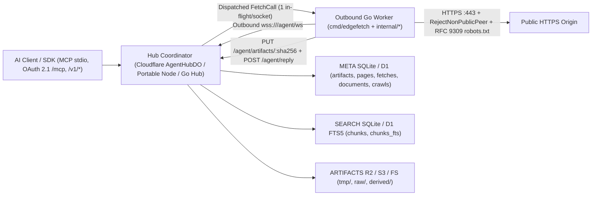

# EdgeFetch Blueprint

## System Overview
EdgeFetch is a self-hosted web scraping, site mapping, search, and browser interaction platform built around a dual-plane architecture:

1. **Control, Extraction, Federation & Storage Plane (`./hub/EGM.md`, `./internal/hub/EGM.md`, `./telemetry/`):** Accepts authenticated REST (`/v1/*`, `/fetch`, Firecrawl v2 & Tavily compatibility routes) and Model Context Protocol (`/mcp` over Streamable HTTP across 17 canonical tools with OAuth 2.1 PKCE, Sign in with GitHub multi-user isolation, or Bearer tokens) requests, federates user-connected downstream MCP servers via an `AES-256-GCM` + `HKDF-SHA256` per-user vault (`discover_mcps` + `query_mcp`), schedules per-host rate limits and 30-minute sticky WAN IP affinities, applies 56 declarative keyless API-twin and HTML site adapters, verifies content-addressed gzipped artifacts (`SHA-256`), and indexes chunked Markdown into `STRICT` SQLite / D1 `FTS5` stores. Runs either on Cloudflare Workers (`AgentHubDO` Hibernating WebSockets + D1 + R2 + Workflows), portable Node.js 22+ / Deno (`node:sqlite` + filesystem/S3 + Turso), or the built-in Go Hub (`edgefetch --mode=hub`).
2. **Outbound-Only Worker Plane (`./cmd/EGM.md`, `./internal/EGM.md`, `./extensions/EGM.md`, `./deploy/EGM.md`):** Single-dependency Go worker nodes (`github.com/coder/websocket` only) and optional Manifest V3 browser-node workers open **zero inbound listening ports**; instead, they dial outbound `wss://<hub>/agent/ws` control channels from residential Home Assistant OS boxes, Proxmox LXC containers, Docker/Kubernetes pods, desktop machines (`edgefetch mcp`), or Android Termux devices. Workers execute HTTP/2 fetches, headless Chromium rendering/interaction (`browser-v1`) behind a loopback HTTP `CONNECT` `SSRFProxy`, and streaming Poppler / OCR PDF extraction (`pdf-v1`).

## Subdirectories & System Boundaries
- `cmd`: [./cmd/EGM.md](./cmd/EGM.md) - Go executable entrypoints: primary `edgefetch` binary supporting daemon (`agent`, `server`, `hub`, hybrid), one-shot CLI (`scrape`, `map`, `crawl`, `update`, `doctor`, `keygen-bot-auth`, `bug-report`), and stdio MCP modes (`./cmd/edgefetch/EGM.md`), plus the pure-stdlib WASI HTML extractor (`./cmd/edgefetch-wasm/EGM.md`).
- `internal`: [./internal/EGM.md](./internal/EGM.md) - Core Go packages implementing the outbound WebSocket worker (`agent`), RFC 9421 Ed25519 Web Bot Auth (`botauth`), headless Chromium CDP renderer & loopback `SSRFProxy` (`browser`), HTTP/WAF outcome classifier (`classify`), polite HTTP/2 batch crawler (`crawl`), GFM Markdown/llms.txt/PDF extractor (`extract`), Go multi-node Hub (`hub`), W3C `traceparent` OTLP + opt-in structural dev error exporter (`otel`), per-host politeness/robots.txt/`RejectNonPublicPeer` dial guard (`politeness`), Linux root-to-`65532` privilege drop (`priv`), and classic-curve WebSocket client (`ws`).
- `hub`: [./hub/EGM.md](./hub/EGM.md) - Cloudflare Worker & Durable Object coordinator (`./hub/src/EGM.md`), Sign in with GitHub (`oauth4webapi` + `jose`), MCP Registry + `AES-256-GCM` connector vault & federated `query_mcp` routing, 56 declarative keyless site & ATS adapters (`./hub/src/extractors/EGM.md`), portable Node.js/Deno servers & S3/Turso/SSRF-safe fetch adapters (`./hub/portable/EGM.md`), `STRICT` D1/SQLite tracking and FTS5 schemas (`./hub/migrations/EGM.md`), and build/test scripts (`./hub/scripts/EGM.md`).
- `telemetry`: Standalone Cloudflare Worker (`telemetry/src/index.ts`) and `STRICT` D1 schema (`telemetry/migrations/0001_errors.sql`) ingesting strictly opted-in, URL/PII-free structural adapter & WAF error fingerprints (`<= 8 KiB` cap, IPv6 `/64` rate limiting).
- `sdk`: [./sdk/EGM.md](./sdk/EGM.md) - Official zero-dependency Python (`./sdk/py/EGM.md`) and TypeScript/ESM (`./sdk/ts/EGM.md`) client SDKs for the Hub `/v1/*` API with multi-gateway active-standby failover.
- `extensions`: [./extensions/EGM.md](./extensions/EGM.md) - Chrome/Edge Manifest V3 Tab Clipper & opt-in SSRF-guarded offscreen WebSocket worker node (`./extensions/browser-clipper/EGM.md`).
- `deploy`: [./deploy/EGM.md](./deploy/EGM.md) - Signature-verified Proxmox VE unprivileged Alpine LXC (`./deploy/proxmox/EGM.md`) and Android Termux (`./deploy/termux/EGM.md`) provisioning scripts alongside declarative container manifests.
- `scripts`: [./scripts/EGM.md](./scripts/EGM.md) - POSIX container entrypoint (`all-in-one-entrypoint.sh`) supervising the portable Node Hub and `env -i`-isolated local Go worker.
- `bench`: [./bench/EGM.md](./bench/EGM.md) - Offline deterministic HTML-to-Markdown extraction fidelity and token-efficiency benchmark suite (`run-bench.mjs`).

## Global Invariants
- **Two-Layer SSRF & Scheme Isolation (`[internal/crawl/server.go:PublicHTTPS]`, `[internal/politeness/politeness.go:RejectNonPublicPeer]`, `[internal/browser/proxy.go:SSRFProxy]`, `[hub/src/overflow.ts:validatePublicHttpsTargetUrl]`, `[hub/portable/safe-fetch.ts:createSafeOutboundFetch]`):** Every target fetch, redirect hop (`<= 5`), webhook, and browser subresource socket requires credential-free public `https://` on port `443` and verifies resolved peer IPs at dial time against loopback, RFC 1918, CGNAT, link-local, metadata, and non-`2000::/3` IPv6 ranges; headless Chromium runs with `--proxy-bypass-list=<-loopback>` and `--host-resolver-rules=MAP * ~NOTFOUND , EXCLUDE 127.0.0.1` so no socket bypasses `SSRFProxy`.
- **Unconditional Politeness, Content Signals & Anti-Bot Honesty (`[internal/crawl/crawl.go:Crawler.shouldCheckRobots]`, `[internal/politeness/politeness.go:ParseRobotsTxt]`, `[internal/classify/classify.go:Classify]`, `[internal/classify/waf.go:ClassifyWAF]`, `[internal/browser/renderer.go:ErrChallengeDetected]`, `[hub/src/waf.ts:classifyWafAndChallenge]`):** Outbound page/scrape requests negotiate `Accept: text/markdown` first; RFC 9309 `/robots.txt` (`512 KiB` cap, distressing to disallow-all on `429`/`5xx`/timeout), `Content-Signal: ai-input=no` opt-outs, and per-host pacing + `Retry-After` cooldowns are enforced on every hop and browser navigation; HTTP `402` (`OutcomePaymentRequired`) is surfaced without auto-payment; CAPTCHAs and WAF challenges immediately return `OutcomeChallenge` and are never solved, clicked through, waited out, or bypassed.
- **Secret & Privilege Isolation (`[hub/src/auth.ts:sameBytes]`, `[hub/src/llm.ts:resolveLlmConfig]`, `[internal/priv/priv_linux.go:LockDownSecretPaths]`, `[internal/priv/priv_linux.go:DropRoot]`, `[scripts/all-in-one-entrypoint.sh:su-exec]`):** Tokens must be `>= 24` chars and compared in constant time; operator LLM API keys are origin- and path-prefix-locked and never sent to untrusted caller `baseUrl` overrides; Linux worker containers lock `/data/options.json` (`0600 root:root`), drop `UID/GID 0 -> 65532:65532` with `PR_SET_NO_NEW_PRIVS=1` + `PR_SET_DUMPABLE=0` across all OS threads, isolate `Dockerfile.all-in-one` into `UID 1000` (Hub) vs `UID 65532` (worker + Chromium), and scrub child subprocess environments.
- **Verified Content-Addressed Artifacts (`[hub/src/storage.ts:handleAgentArtifactUpload]`, `[hub/src/ingest.ts:verifyStoredArtifact]`, `[internal/hub/hub.go:Server.handleAgentArtifactPut]`):** Worker artifact uploads (`<= 18 MiB` gzipped / `<= 16 MiB` uncompressed) require active `(jobId, jobNonce, siteId)` ownership and streamed `SHA-256` proof-of-possession before indexing into `META` or `SEARCH` `FTS5` tables (`STRICT` SQLite typing) and never delete pre-existing verified R2 blobs on mismatched claims.
- **Minimal Dependency & Supply-Chain Footprint (`[go.mod]`, `[hub/package.json]`, `[.github/workflows/release.yml]`):** The Go module depends solely on `github.com/coder/websocket` (strictly 1 external dependency, zero transitive dependencies); the TypeScript Hub restricts runtime `dependencies` strictly to 6 pinned packages (`htmlparser2`, `jose`, `oauth4webapi`, `re2js`, `ws`, `yaml`); release `checksums.txt` manifests are raw Ed25519-signed inside the tag-gated `release` GitHub Actions environment (`keys/release-signing-pub.pem`) prior to publication alongside GitHub SLSA build-provenance attestations.

## Global Side Effects
- **Outbound Network & Control Channels:** Establishes outbound `wss://<hub>/agent/ws` control WebSockets, `HTTPS :443` target/twin/robots/search/LLM/webhook requests, and optional OTLP/HTTP JSON `/v1/traces` exports (`W3C traceparent`).
- **Storage & State Mutations:** Mutates Durable Object / local SQLite coordination tables (`AgentHubDO`), `META` D1/SQLite tracking tables (`artifacts`, `pages`, `fetches`, `documents`, `crawls`, `agent_runs`, `search_cache`), `SEARCH` D1/SQLite `FTS5` tables (`chunks`, `chunks_fts`), and `ARTIFACTS` R2/S3/filesystem object stores (`tmp/`, `raw/`, `derived/`).
- **Local Subprocesses & OS State:** Spawns optional headless Chromium (`browser-v1`) and Poppler `pdftotext` (`pdf-v1`) child processes with temporary `/tmp` profiles/streams, drops Linux container privileges to `65532:65532`, and writes MCP client or OS service configs only when explicitly invoked via CLI installer subcommands.

## System Verification
- Run: `make test && make hub-test`
