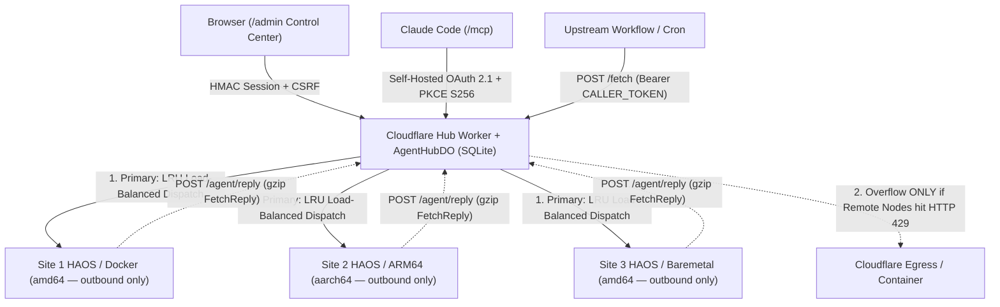

# EdgeFetch

[](https://github.com/bartrumb/edgefetch/actions/workflows/ci.yml)
[-00ADD8?logo=go)](go.mod)
[](LICENSE)

<p>
  <a href="https://deploy.workers.cloudflare.com/?url=https://github.com/bartrumb/edgefetch/tree/main/hub">
    
  </a>
  &nbsp;
  <a href="https://my.home-assistant.io/redirect/supervisor_add_addon_repository/?repository_url=https%3A%2F%2Fgithub.com%2Fbartrumb%2Fedgefetch">
    
  </a>
</p>

**EdgeFetch** is a security-hardened, **zero-dependency Go HTTP/2 fetcher** and **outbound-only distributed standby worker** paired with a **Cloudflare Hibernating WebSocket Durable Object** coordinator (`hub/` — complete with a built-in `/admin` Control Center and self-hosted OAuth 2.1 `/mcp` server) and a **1-click Home Assistant OS Add-on**.

It solves a practical distributed-systems problem: keeping scheduled public feed/document syncs resilient across primary cloud containers (`--mode=server`) and geo-distributed standby hardware (`--mode=agent`) **without** opening inbound router ports, running forward HTTP/SOCKS proxies, installing VPN/tunnel daemons, or pulling in third-party Go packages.

<p align="center">
  
</p>

---

## Why EdgeFetch?

- **100% Go Standard Library (`go.sum`-free):** HTTP/2 connection pooling, `net/http/httptrace` phase telemetry, RFC 6455 TLS WebSocket framing, RFC 9309 `robots.txt` longest-match + unreachable-disallow evaluation, RFC 9110 `Retry-After` parsing, three-state circuit breaking, and Linux `prctl` + `setuid` privilege dropping are implemented in ~2,300 lines of idiomatic Go with **zero external supply-chain dependencies**.
- **Strict Hub / Edge Security Split (~$0 Idle Cloud Cost):**
  - **Edge Nodes (`amd64` / `aarch64`)** host **zero** inbound HTTP, `/admin`, or `/mcp` endpoints. They dial outbound `wss://` to `/agent/ws`, where Cloudflare's `WebSocketRequestResponsePair("ping", "pong")` answers 30-second keepalives at the edge **without waking the Durable Object from hibernation**.
  - **Cloudflare Hub (`hub/`)** is the sole public control plane — hosting `POST /fetch`, `GET /agents`, the `/admin` Web Control Center, and the OAuth 2.1 `/mcp` server for Claude Code.
- **Split Control / Data Plane for Asymmetric Links:** Small JSON dispatch commands arrive over the hibernated WebSocket (`< 1 MiB`), while `0.4–16 MiB` HTML/JSON responses stream back via `gzip`-compressed HTTP/2 `POST /agent/reply` (~8–10x smaller over residential upload pipes, never stalling WebSocket heartbeats, with independent shutdown-drain upload contexts so completed results are never lost on `SIGTERM`).
- **Defense-in-Depth Security ([SECURITY.md](SECURITY.md)):**
  - Dial-time `net.Dialer.Control` SSRF guard (`RejectNonPublicPeer` backed by `net/netip`) inspects the exact resolved IP right before `connect()` — eliminating DNS-rebinding TOCTOU races and blocking `0.0.0.0/8`, RFC 1918 LANs (including Home Assistant's `172.30.32.0/23` bridge), loopback, Tailscale/CGNAT (`100.64.0.0/10`), cloud metadata (`169.254.169.254`), site-local (`fec0::/10`), and IPv6-embedded IPv4 transition prefixes (`::/96`, `0:0:0:0:ffff:0::/96`, `64:ff9b::/96` NAT64, `2002::/16` 6to4, `2001::/32` Teredo).
  - Irreversible Linux privilege drop (`PR_SET_NO_NEW_PRIVS` -> `Setgroups([])` -> `Setgid(65532)` -> `Setuid(65532)` via `AllThreadsSyscall`) inside a **~9 MB shell-free `distroless`** image confined by a custom Home Assistant AppArmor profile.
  - Strictly separated least-privilege tokens (`CALLER_TOKEN`, per-site `AGENT_TOKENS`, and mandatory `EDGEFETCH_SERVER_TOKEN` on non-loopback `--mode=server` binds) verified in constant time, plus per-job `jobNonce` binding.

---

## Architecture



---

## Package Layout

| Package | Responsibility |
|---|---|
| [`cmd/edgefetch`](cmd/edgefetch/main.go) | Dual-mode binary entrypoint (`server` vs outbound-only `agent`), HTTP/2 transport tuning, `SIGTERM` graceful drain |
| [`internal/politeness`](internal/politeness/politeness.go) | Context-cancellable `chan struct{}` per-host locks, `robots.txt` cache, 3-state circuit breaker, `RejectNonPublicPeer` SSRF hook |
| [`internal/classify`](internal/classify/classify.go) | Defined string enums (`Kind`, `Outcome`) and panic-free JSON/HTML response classification |
| [`internal/crawl`](internal/crawl/crawl.go) | Bounded worker pool, positive dwell jitter (`PauseJitterMs`), `httptrace` phase timing, `io.LimitReader(max+1)`, `/fetch` handler |
| [`internal/ws`](internal/ws/client.go) | Zero-dependency stdlib RFC 6455 TLS WebSocket client (`http/1.1` ALPN, frame masking, fragmented-frame assembly) |
| [`internal/priv`](internal/priv/priv_linux.go) | Linux `prctl(PR_SET_NO_NEW_PRIVS)` + `AllThreadsSyscall` irreversible root drop (`65532:65532`) |
| [`internal/agent`](internal/agent/agent.go) | `/data/options.json` + env loader, jittered reconnect supervisor, `agent_hello` OTel telemetry, gzipped reply uploader |
| [`edgefetch_agent/`](edgefetch_agent/config.yaml) | Multi-arch (`amd64` + `aarch64`) Home Assistant OS Add-on manifest, `apparmor.txt`, and `distroless` Dockerfile |
| [`hub/`](hub/src/index.ts) | Cloudflare Hub Worker + `AgentHubDO` SQLite coordinator + `/admin` Web UI + Self-Hosted OAuth 2.1 `/mcp` server |

- Operations, C&C protocol, tuning, `/admin`, & Claude Code MCP guide: **[docs/USAGE.md](docs/USAGE.md)**
- Deep-dive systems & Go concurrency walkthrough: **[docs/INTERNALS.md](docs/INTERNALS.md)**

---

## Benchmarks (`go test -bench=. -benchmem ./...`)

Measured on Linux `amd64` (12th Gen Intel Core i9-12900K, Go stdlib only):

| Benchmark | Latency | Throughput | Heap Allocations |
|---|---:|---:|---:|
| `BenchmarkParseRetryAfter` | `4.45 ns/op` | — | **`0 B/op` (`0 allocs/op`)** |
| `BenchmarkRobotsMatch` (`*` wildcards + `$` anchor) | `52.17 ns/op` | — | **`0 B/op` (`0 allocs/op`)** |
| `BenchmarkIsPublicIP` (IPv4 + NAT64 IPv6 check) | `155.50 ns/op` | — | **`0 B/op` (`0 allocs/op`)** |
| `BenchmarkMaskBytes1KiB` (RFC 6455 XOR masking) | `415.10 ns/op` | `2,467 MB/s` | **`0 B/op` (`0 allocs/op`)** |
| `BenchmarkClassifyFeedJSON` | `1,229 ns/op` | — | `1,416 B/op` (`28 allocs/op`) |

---

## Quickstart (1-Click Easy Buttons)

### 1. 1-Click Deploy the Cloudflare Hub (`hub/`)

[](https://deploy.workers.cloudflare.com/?url=https://github.com/bartrumb/edgefetch/tree/main/hub)

Clicking **Deploy to Cloudflare** clones `hub/`, provisions `AgentHubDO` (SQLite), and interactively prompts you in the Cloudflare dashboard for `CALLER_TOKEN` and `AGENT_TOKENS` (defined in [`hub/.dev.vars.example`](hub/.dev.vars.example) and [`hub/package.json`](hub/package.json)).

Or deploy from your terminal (or `.github/workflows/deploy-hub.yml` with `CLOUDFLARE_API_TOKEN`):

```bash
cd hub
npm install
npx wrangler deploy -c wrangler.toml
npx wrangler secret put CALLER_TOKEN -c wrangler.toml
npx wrangler secret put AGENT_TOKENS -c wrangler.toml
# Example AGENT_TOKENS JSON: {"site-1":"<32-char-random>","site-2":"<32-char-random>"}
```

### 2. 1-Click Install on Home Assistant OS (`amd64` & `aarch64`)

[](https://my.home-assistant.io/redirect/supervisor_add_addon_repository/?repository_url=https%3A%2F%2Fgithub.com%2Fbartrumb%2Fedgefetch)

1. Click **Add Repository to My Home Assistant** above (or manually open **Settings -> Add-ons -> Add-on Store -> `⋮` -> Repositories** and add `https://github.com/bartrumb/edgefetch`).
2. Install **EdgeFetch Cold-Standby Worker**, open **Configuration**, set `hub_url`, `agent_token`, `site_id`, and `user_agent`, and click **Start**.

### 3. Drive, Monitor & Tune After Setup (Full Reference in [`docs/USAGE.md`](docs/USAGE.md))

- **Web Control Center (`/admin`):** Open `https://<your-hub>.workers.dev/admin` and sign in with `CALLER_TOKEN` to view live connected edge nodes, 15-minute domain-affinity pins, active OAuth grants, and an interactive URL Crawl Tester with a visual **DNS / TCP / TLS / TTFB** waterfall bar.
- **Connect Directly to Claude Code (`/mcp` with Self-Hosted OAuth 2.1 + PKCE):**
  ```bash
  claude mcp add --transport http edgefetch https://<your-hub>.workers.dev/mcp
  ```
  Claude Code auto-discovers RFC 9728 / RFC 8414 metadata, dynamically registers (`POST /oauth/register`), and opens `/oauth/authorize` in your browser to grant `list_agents`, `fetch_url`, and `fetch_batch` tools — zero external IdP, zero separate KV namespace, and zero raw tokens stored in config files.
- **Trigger Polite Crawls via REST (`POST /fetch`):**
  ```bash
  curl -X POST "https://<your-hub>.workers.dev/fetch?site=site-1" \
    -H "Authorization: Bearer $CALLER_TOKEN" \
    -H "Content-Type: application/json" \
    -d '{"options":{"includeBody":true,"respectRobots":true,"pauseMs":1500},"requests":[{"id":"1","url":"https://example.com/","kind":"page"}]}'
  ```
- **Single-Pane-of-Glass Logs & Traces:** Open **Cloudflare Dashboard -> Workers & Pages -> `edgefetch-hub` -> Observability** to query OpenTelemetry traces and structured JSON logs across every site.

---

## Ethical Crawling, Public-IP Host Affinity & Polite `429` Failover

EdgeFetch is an **honest, rate-limited HTTP fetcher** — never a stealth scraper or anti-bot bypass tool:
- **Honest Identity & Standard TLS:** Always sends a transparent, configurable `User-Agent` (validated printable ASCII) and standard Go `net/http` TLS/HTTP2 stacks; never solves CAPTCHAs or spoofs browser fingerprints.
- **`/robots.txt` On by Default (RFC 9309):** Both Go (`--mode=server` / `--mode=agent`) and the Cloudflare Hub overflow enforce `/robots.txt` **by default** (`options.respectRobots = true` unless explicitly set `false`), including `Allow`/`Disallow` longest-match, `Crawl-delay`, and RFC 9309 §2.3.1.4 complete-disallow when `/robots.txt` is unreachable or returns `429`/`5xx`.
- **Public-IP Load Splitting + 30-Minute Host-Sticky Affinity:** `AgentHubDO` groups connected edge nodes by verified public egress IP (`cf-connecting-ip`), assigns each origin host to the Least-Recently-Used public IP group, and pins that host for 30 minutes so **requests to a single origin never rotate addresses** (preserving warm HTTP/2 connections), while distinct origins split evenly across distinct public IPs. Concurrent requests to the same host serialize through a race-free in-DO FIFO lock (`withHostLocks`).
- **Refusals vs. Polite `429` Cooldown & Wait:**
  - `403`, `503`, and anti-bot challenges (`cf-mitigated`) **stop immediately** with zero retries anywhere.
  - On HTTP `429`, `AgentHubDO` cools down both `siteId` and `ip:<publicIp>` in SQLite (`site_cooldowns`) so sibling nodes behind the same WAN IP are skipped, and **waits out the origin's full `Retry-After` window** (or a `15 s` default throttle pause when `Retry-After` is absent) inside the host lock **before** any failover node or Cloudflare overflow re-attempts that host. If `Retry-After` exceeds the request's `maxSeconds` budget, the `429` is returned directly to the caller without failing over. Pin `?target=agent&site=<id>` whenever single-IP non-failover behavior is desired.

## License

[MIT](LICENSE)
