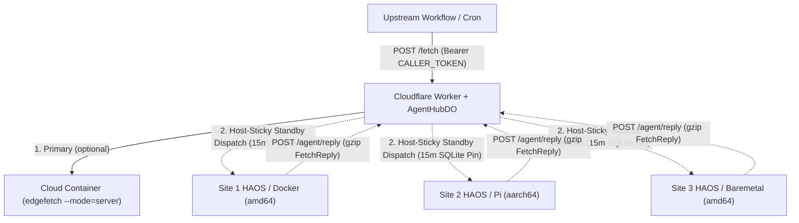

# EdgeFetch

[](https://github.com/bartrumb/edgefetch/actions/workflows/ci.yml)
[-00ADD8?logo=go)](go.mod)
[](LICENSE)

**EdgeFetch** is a security-hardened, **zero-dependency Go HTTP/2 fetcher** and **outbound-only distributed standby worker** paired with a **Cloudflare Hibernating WebSocket Durable Object** coordinator and a **1-click Home Assistant OS Add-on**.

It solves a practical distributed-systems problem: keeping scheduled public feed/document syncs resilient across primary cloud containers (`--mode=server`) and geo-distributed standby hardware (`--mode=agent`) **without** opening inbound router ports, running forward HTTP/SOCKS proxies, installing VPN/tunnel daemons, or pulling in third-party Go packages.

---

## Why EdgeFetch?

- **100% Go Standard Library (`go.sum`-free):** HTTP/2 connection pooling, `net/http/httptrace` phase telemetry, RFC 6455 TLS WebSocket framing, RFC 9309 `robots.txt` longest-match evaluation, RFC 9110 `Retry-After` parsing, three-state circuit breaking, and Linux `prctl` + `setuid` privilege dropping are implemented cleanly in ~1,400 lines of idiomatic Go with **zero external supply-chain dependencies**.
- **Outbound-Only Standby Architecture (~$0 Idle Cloud Cost):** Standby nodes (`amd64` / `aarch64`) dial outbound `wss://` to a Cloudflare Hibernating WebSocket Durable Object (`AgentHubDO`). Cloudflare's `WebSocketRequestResponsePair("ping", "pong")` answers 30-second keepalives at the edge **without waking the Durable Object from hibernation**.
- **Split Control / Data Plane for Asymmetric Links:** Small JSON dispatch commands arrive over the hibernated WebSocket (`< 1 MiB`), while `0.4–16 MiB` HTML/JSON responses stream back via `gzip`-compressed HTTP/2 `POST /agent/reply` (~8–10x smaller over residential upload pipes, never stalling WebSocket heartbeats).
- **Defense-in-Depth Security ([SECURITY.md](SECURITY.md)):**
  - Kernel-level `net.Dialer.Control` SSRF guard (`RejectNonPublicPeer`) inspects the exact resolved IP right before `connect()` — eliminating DNS-rebinding TOCTOU races and blocking RFC 1918 LANs (including Home Assistant's `172.30.32.0/23` bridge), loopback, Tailscale/CGNAT (`100.64.0.0/10`), cloud metadata (`169.254.169.254`), and IPv6-embedded IPv4 transition prefixes (`64:ff9b::/96` NAT64, `2002::/16` 6to4, `2001::/32` Teredo).
  - Irreversible Linux privilege drop (`PR_SET_NO_NEW_PRIVS` -> `Setgroups([])` -> `Setgid(65532)` -> `Setuid(65532)` via `AllThreadsSyscall`) inside a **~9 MB shell-free `distroless`** image confined by a custom Home Assistant AppArmor profile.
  - Strictly separated least-privilege tokens (`CALLER_TOKEN` vs. per-site `AGENT_TOKENS`) verified in length-independent constant time, plus per-job `jobNonce` binding.

---

## Architecture



---

## Package Layout

| Package | Responsibility |
|---|---|
| [`cmd/edgefetch`](cmd/edgefetch/main.go) | Dual-mode binary entrypoint (`server` vs `agent`), HTTP/2 transport tuning, `SIGTERM` graceful drain |
| [`internal/politeness`](internal/politeness/politeness.go) | Context-cancellable `chan struct{}` per-host locks, `robots.txt` cache, 3-state circuit breaker, `RejectNonPublicPeer` SSRF hook |
| [`internal/classify`](internal/classify/classify.go) | Defined string enums (`Kind`, `Outcome`) and panic-free JSON/HTML response classification |
| [`internal/crawl`](internal/crawl/crawl.go) | Bounded worker pool, positive dwell jitter (`PauseJitterMs`), `httptrace` phase timing, `io.LimitReader(max+1)`, `/fetch` handler |
| [`internal/ws`](internal/ws/client.go) | Zero-dependency stdlib RFC 6455 TLS WebSocket client (`http/1.1` ALPN, frame masking, fragmented-frame assembly) |
| [`internal/priv`](internal/priv/priv_linux.go) | Linux `prctl(PR_SET_NO_NEW_PRIVS)` + `AllThreadsSyscall` irreversible root drop (`65532:65532`) |
| [`internal/agent`](internal/agent/agent.go) | `/data/options.json` + env loader, jittered reconnect supervisor, `agent_hello` OTel telemetry, gzipped reply uploader |
| [`edgefetch_agent/`](edgefetch_agent/config.yaml) | Multi-arch (`amd64` + `aarch64`) Home Assistant OS Add-on manifest, `apparmor.txt`, and `distroless` Dockerfile |
| [`hub/`](hub/src/index.ts) | Reference Cloudflare Worker + SQLite-backed Hibernating WebSocket Durable Object (`AgentHubDO`) |

Deep-dive systems & Go concurrency walkthrough: **[docs/INTERNALS.md](docs/INTERNALS.md)**.

---

## Benchmarks (`go test -bench=. -benchmem ./...`)

Measured on Linux `amd64` (12th Gen Intel Core i9-12900K, Go stdlib only):

| Benchmark | Latency | Throughput | Heap Allocations |
|---|---:|---:|---:|
| `BenchmarkParseRetryAfter` | `4.45 ns/op` | — | **`0 B/op` (`0 allocs/op`)** |
| `BenchmarkRobotsMatch` (`*` wildcards + `$` anchor) | `52.17 ns/op` | — | **`0 B/op` (`0 allocs/op`)** |
| `BenchmarkIsPublicIP` (IPv4 + NAT64 IPv6 check) | `229.60 ns/op` | — | **`0 B/op` (`0 allocs/op`)** |
| `BenchmarkMaskBytes1KiB` (RFC 6455 XOR masking) | `415.10 ns/op` | `2,467 MB/s` | **`0 B/op` (`0 allocs/op`)** |
| `BenchmarkClassifyFeedJSON` | `1,229 ns/op` | — | `1,416 B/op` (`28 allocs/op`) |

---

## Quickstart

### 1. Run Locally & Test with the Race Detector

```bash
go vet ./...
go test -race -count=1 ./...
go test -bench=. -benchmem ./...

# Start in HTTP server mode on :8080
go run ./cmd/edgefetch --mode=server
```

### 2. Deploy the Companion Cloudflare Hub (`hub/`)

```bash
cd hub
npm install
npx wrangler deploy -c wrangler.toml
npx wrangler secret put CALLER_TOKEN -c wrangler.toml
npx wrangler secret put AGENT_TOKENS -c wrangler.toml
# Example AGENT_TOKENS JSON: {"site-1":"<32-char-random>","site-2":"<32-char-random>"}
```

### 3. 1-Click Install on Home Assistant OS (`amd64` & `aarch64`)

1. Open **Settings -> Add-ons -> Add-on Store -> ⋮ -> Repositories** and add:
   ```text
   https://github.com/bartrumb/edgefetch
   ```
2. Install **EdgeFetch Cold-Standby Worker**, open **Configuration**, set `hub_url`, `agent_token`, `site_id`, and `user_agent`, and click **Start**.
3. Check live connected standby nodes from anywhere:
   ```bash
   curl -H "Authorization: Bearer $CALLER_TOKEN" https://your-hub.workers.dev/agents
   ```

---

## Ethical & Polite Crawling Principles

EdgeFetch is strictly an **honest, rate-limited HTTP fetcher** — never a stealth scraper or anti-bot bypass tool:
- Always sends a transparent, configurable `User-Agent` (validated printable ASCII) and standard Go `net/http` TLS/HTTP2 stacks.
- Enforces per-host `Burst = 1` serialization, `/robots.txt` `Allow`/`Disallow` + `Crawl-delay` caching, conditional `If-None-Match` / `If-Modified-Since` (`304 Not Modified`), and `Retry-After` cooldowns.
- Never retries `403`, `429`, `503`, or `cf-mitigated` challenges.

## License

[MIT](LICENSE)
