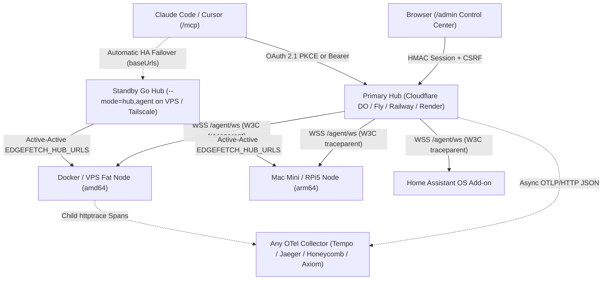

# EdgeFetch

[](https://github.com/bartrumb/edgefetch/actions/workflows/ci.yml)
[](go.mod)
[](https://pkg.go.dev/github.com/bartrumb/edgefetch)
[](LICENSE)

<p>
  <a href="https://deploy.workers.cloudflare.com/?url=https://github.com/bartrumb/edgefetch/tree/main/hub">
    
  </a>
  &nbsp;
  <a href="https://render.com/deploy?repo=https://github.com/bartrumb/edgefetch">
    
  </a>
  &nbsp;
  <a href="https://railway.com/new/github/bartrumb/edgefetch">
    
  </a>
  &nbsp;
  <a href="https://fly.io/docs/hands-on/launch-app/">
    
  </a>
  &nbsp;
  <a href="https://my.home-assistant.io/redirect/supervisor_add_addon_repository/?repository_url=https%3A%2F%2Fgithub.com%2Fbartrumb%2Fedgefetch">
    
  </a>
</p>

**EdgeFetch** (`v2.1`) is a self-hosted **scrape, map, crawl, extract, interact, and search** platform for AI agents — deployable on **Cloudflare Workers**, **Fly.io**, **Railway**, **Render**, **Docker Compose**, or **a single 9 MB static Go binary**, paired with **outbound-only Go worker nodes** (`amd64` & `arm64` Docker, Home Assistant OS, Raspberry Pi, NAS, or VPS) with HTTP/2, SSRF-proxied Headless Chromium, and streaming Poppler PDF.

Unlike self-hosted Firecrawl (which requires Redis, PostgreSQL, RabbitMQ, and a separate Playwright cluster under AGPL-3.0), EdgeFetch is **MIT-licensed**, uses **one external Go dependency (`coder/websocket`, zero transitive dependencies)**, opens **zero inbound router ports** on worker nodes, exports **vendor-agnostic OpenTelemetry (`OTLP/HTTP` + W3C `traceparent`)** traces to any collector, and idles near **$0/month** on Cloudflare Hibernating WebSocket Durable Objects or a single container.

<p align="center">
  
</p>

---

## Why EdgeFetch?

- **Minimal Go Supply Chain (One Dependency, Zero Transitive Dependencies):** HTTP/2 connection pooling, `net/http/httptrace` phase telemetry, zero-allocation RFC 9309 `robots.txt` matching, RFC 9110 `Retry-After` parsing, three-state circuit breaking, OpenTelemetry OTLP/HTTP trace export, and Linux `prctl` + `setuid` privilege dropping use the Go standard library plus `github.com/coder/websocket` — verified continuously under `-race` and native Go fuzzing (`Fuzz*`).
- **Run Anywhere — Multi-Edge, All-in-One Container, or Pure Go Controller (`--mode=hub`):**
  - **Cloudflare Hub (`hub/`):** Hibernating WebSocket Durable Object (`AgentHubDO`) + optional R2 + D1 + D1 FTS5 (`~$0` idle cost).
  - **All-in-One Portable Container (`Dockerfile.all-in-one`):** Runs the full TypeScript Hub (`/admin`, OAuth 2.1, 11-tool `/mcp`, `node:sqlite` FTS5, `/data` artifacts) + local Go Chromium/Poppler worker in **one container** on Fly.io (`fly.toml`), Railway (`railway.json`), Render (`render.yaml`), Coolify, or `docker compose up` — zero Postgres, zero Redis.
  - **Pure Go Controller & HA Mesh (`edgefetch --mode=hub` / `--mode=hub,agent`):** The exact same ~9 MB static Go binary can act as a central WebSocket controller (`/agent/ws`, `/v1/scrape`, `/fetch`, `/mcp`), an outbound worker (`--mode=agent` with active-active `EDGEFETCH_HUB_URLS` multi-controller fan-out), or a hybrid Tailscale/LAN standby controller (`--mode=hub,agent`).
- **Best-of-Breed Open-Source Extraction (`SCRAPE_PIPELINE_VERSION = 19`):**
  - Sentinel-protected `<pre><code>` & multi-backtick inline `<code>` conversion preserves generic types (`Promise<void>`, `#include <stdio.h>`), GFM tables, footnotes (`[^1]`), `<figure>/<figcaption>`, callouts (`> [!NOTE]`), and LaTeX math.
  - Native converters for **Jupyter Notebooks (`.ipynb`)**, **OpenAPI 3.x / Swagger 2.0**, **RSS/Atom XML**, **CSV/TSV**, **iCalendar (`.ics`)**, **vCard (`.vcf`)**, **Git `.patch` diffs**, **source/config files**, **Hacker News**, **Substack**, **GitHub Issues/PRs**, **ArXiv**, **Sphinx**, **YouTube transcripts**, **`/llms.txt` companion `.md`**, and **256 MiB streaming Poppler PDFs** (with optional external OCR).
- **11-Tool Dual-Era OAuth 2.1 MCP Server (`2026-07-28` & `2025-03-26`) + Firecrawl / Tavily Drop-In Compat:**
  - Exposes `list_agents`, `scrape`, `extract`, `map`, `crawl`, `search` (Serper + Brave + Tavily + SearXNG + `edge-map` + private D1 FTS5 fused via Reciprocal Rank Fusion with foreign locale deduplication), `search_collection`, `interact`, `read_artifact`, `fetch_url`, and `fetch_batch`, plus `/compat/firecrawl/v2/*`, `/compat/tavily/*`, and [`sdk/ts/edgefetch-client.ts`](sdk/ts/edgefetch-client.ts) (with `baseUrls` automatic multi-controller HA failover).
- **Vendor-Agnostic OpenTelemetry (`OTLP/HTTP` + W3C `traceparent`):**
  - Set `OTEL_EXPORTER_OTLP_ENDPOINT` + `OTEL_EXPORTER_OTLP_HEADERS` on Hub and/or Go nodes to stream stitched parent/child `httptrace` (`dnsMs`, `connectMs`, `tlsMs`, `ttfbMs`, `reused`) waterfalls directly to **Grafana Tempo**, **Jaeger**, **Honeycomb**, **Axiom**, **SigNoz**, or any OTLP collector at zero added caller latency.
- **Defense-in-Depth Security ([SECURITY.md](SECURITY.md)):**
  - Dial-time `net.Dialer.Control` SSRF guard (`RejectNonPublicPeer`) eliminates DNS-rebinding TOCTOU races; headless Chromium subresources are forced through an in-process loopback `SSRFProxy` (`CONNECT` + `MAP * ~NOTFOUND`); anti-bot/CAPTCHA pages halt immediately and are never bypassed.

---

## Architecture & High-Availability Mesh



---

## Quickstart — Pick Your Deployment Mode

### Option A: 1-Command Standalone Worker Container (Any Linux, macOS, Windows, NAS, RPi, or VPS)

No Home Assistant required! Multi-arch OCI manifests (`linux/amd64` + `linux/arm64`) run as non-root `65532:65532`:

```bash
# Full "Fat" Agent (Go HTTP/2 + SSRF-proxied Headless Chromium + SwiftShader + Poppler PDF):
docker run -d --name edgefetch-agent --restart=unless-stopped \
  --security-opt no-new-privileges:true \
  -e EDGEFETCH_HUB_URL=https://<your-hub-domain> \
  -e EDGEFETCH_AGENT_TOKEN="<YOUR_AGENT_TOKEN>" \
  -e EDGEFETCH_SITE_ID="node-1" \
  ghcr.io/bartrumb/edgefetch-agent:latest

# Or Ultra-Light 9 MB Distroless Agent (HTTP/2 + Markdown + pure-Go PDF, ~15 MB RAM):
docker run -d --name edgefetch-lite --restart=unless-stopped --read-only \
  -e EDGEFETCH_HUB_URL=https://<your-hub-domain> \
  -e EDGEFETCH_AGENT_TOKEN="<YOUR_AGENT_TOKEN>" \
  -e EDGEFETCH_SITE_ID="lite-1" \
  ghcr.io/bartrumb/edgefetch-agent:lite --mode=agent
```

Or use [`compose.agent.yaml`](compose.agent.yaml): `docker compose -f compose.agent.yaml up -d`.

### Option B: Zero-Cloud Local Stack (`docker compose up` in 20 Seconds)

Spin up the full Hub (`/admin`, OAuth 2.1, 11-tool `/mcp`, SQLite FTS5, `/data` artifacts) + 2 local Go Chromium worker nodes (`local-node-1`, `local-node-2`) with **zero cloud account**:

```bash
git clone https://github.com/bartrumb/edgefetch.git
cd edgefetch
docker compose up --build -d
# Open http://localhost:8787/admin (default token: local-dev-caller-token-0123456789)
```

### Option C: Standalone Go CLI & Self-Hosted Go Hub (`go install`)

```bash
go install github.com/bartrumb/edgefetch/cmd/edgefetch@latest

# 1. Verify SSRF guard, loopback CONNECT proxy, Chromium & pdftotext:
edgefetch doctor

# 2. Polite one-shot terminal scrape to clean Markdown (or --json with httptrace timings):
edgefetch scrape https://example.com
edgefetch scrape --json --query="installation" https://developers.cloudflare.com/workers/

# 3. Run a 100% self-hosted Go WebSocket Hub + /v1/scrape + /mcp controller on a $4 VPS:
EDGEFETCH_CALLER_TOKEN="<32-char-secret>" EDGEFETCH_AGENT_TOKEN="<32-char-secret>" \
  edgefetch --mode=hub --addr=0.0.0.0:8080
```

### Option D: 1-Click Cloud Hub (Cloudflare Workers, Render, Railway, Fly.io) & Home Assistant OS

1. **Cloudflare Workers (`~$0` idle):** Click **Deploy to Cloudflare** at the top of this page (or `cd hub && npm ci && npx wrangler deploy`).
2. **Render / Railway / Fly.io (Single All-in-One Container + Persistent `/data` Volume):**
   - Click **Deploy to Render** ([`render.yaml`](render.yaml)) or **Deploy on Railway** ([`railway.json`](railway.json)), or run `fly launch --copy-config` ([`fly.toml`](fly.toml)).
3. **Home Assistant OS (`amd64` & `aarch64`):** Click **Add Repository to Home Assistant** above, install **EdgeFetch**, set `hub_url`, `agent_token`, and `site_id`, and click **Start**.

---

## Package Layout & Documentation

| Package | Responsibility |
|---|---|
| [`cmd/edgefetch`](cmd/edgefetch/main.go) | Multi-mode binary (`server`, `agent`, `hub`, `hub,agent`) + one-shot CLI (`scrape`, `doctor`, `version`) |
| [`internal/hub`](internal/hub/hub.go) | Self-hosted Go WebSocket controller (`/agent/ws`, `/agent/artifacts`, `/agent/reply`, `/v1/scrape`, `/mcp`) |
| [`internal/agent`](internal/agent/agent.go) | Outbound worker supervisor, `EDGEFETCH_HUB_URLS` active-active HA fan-out, direct R2 artifact streaming |
| [`internal/otel`](internal/otel/otlp.go) | W3C `traceparent` parser/formatter & non-blocking `OTLP/HTTP` JSON span exporter |
| [`internal/politeness`](internal/politeness/politeness.go) | Context-aware per-host locks, zero-alloc RFC 9309 `robots.txt` matcher, circuit breaker, `RejectNonPublicPeer` SSRF hook |
| [`internal/classify`](internal/classify/classify.go) | Deterministic HTTP/JSON/PDF/challenge outcome classification |
| [`internal/crawl`](internal/crawl/crawl.go) | Bounded HTTP/2 worker pool, hop-by-hop redirect validation, `httptrace` telemetry, 256 MiB disk-streamed PDFs |
| [`internal/extract`](internal/extract/extract.go) | Pure-stdlib HTML -> GFM Markdown (code-stash `<T>` safe), branding, BM25 reranker, `llms.txt`, Poppler/pure-Go PDF |
| [`internal/browser`](internal/browser/renderer.go) | Loopback `SSRFProxy` (`CONNECT` + `MAP * ~NOTFOUND`), CDP client, stateful `interact` |
| [`internal/ws`](internal/ws/client.go) | Hardened `coder/websocket` client (`http/1.1` ALPN, classic ECDHE TLS curves, 1 MiB frame cap) |
| [`internal/priv`](internal/priv/priv_linux.go) | Linux `prctl(PR_SET_NO_NEW_PRIVS)` + `AllThreadsSyscall6` irreversible root drop (`65532:65532`) |
| [`hub/`](hub/src/index.ts) & [`hub/portable/`](hub/portable/portable-server.ts) | Cloudflare Worker/DO Hub + Portable Node 22+ `node:sqlite` FTS5 server + `/admin` wizard + OAuth 2.1 `/mcp` |
| [`sdk/ts/`](sdk/ts/edgefetch-client.ts) | Zero-dependency TypeScript client SDK (`EdgeFetchClient` with `baseUrls` HA failover) |

- **Operations, OTLP Tracing, HA Mesh & MCP Guide:** **[docs/USAGE.md](docs/USAGE.md)**
- **Hub ↔ Go Agent Wire Protocol Spec:** **[docs/PROTOCOL.md](docs/PROTOCOL.md)**
- **Systems & Go Concurrency Internals:** **[docs/INTERNALS.md](docs/INTERNALS.md)**
- **Security Threat Model & SSRF Controls:** **[SECURITY.md](SECURITY.md)**

---

## Controller Capacity & Microbenchmarks

| Controller Runtime | Idle Cost per Agent | Practical Connected Fleet | Cross-Domain Throughput (50 Nodes) |
|---|---|---:|---:|
| **Go Controller (`--mode=hub`, 2 vCPU / 2 GB VPS)** | `~25–40 KiB` RAM | `5,000 – 15,000` agents | `~750 – 2,000` HTTP/2 scrapes/sec |
| **Cloudflare Hub (`AgentHubDO` Hibernating WS)** | `$0` idle duration | `500 – 2,000` agents / shard (`HUB_SHARDS` scales horizontally) | `~750 – 2,000` HTTP/2 scrapes/sec |

| Go Benchmark (`go test -bench=. -benchmem ./...`) | Latency | Heap Allocations |
|---|---:|---:|
| `BenchmarkParseRetryAfter` | `4.45 ns/op` | **`0 B/op` (`0 allocs/op`)** |
| `BenchmarkRobotsMatch` (`*` wildcards + `$` anchor) | `52.17 ns/op` | **`0 B/op` (`0 allocs/op`)** |
| `BenchmarkIsPublicIP` (IPv4 + NAT64 IPv6 check) | `155.50 ns/op` | **`0 B/op` (`0 allocs/op`)** |
| `BenchmarkClassifyFeedJSON` | `1,229 ns/op` | `1,416 B/op` (`28 allocs/op`) |

## License

[MIT](LICENSE)
