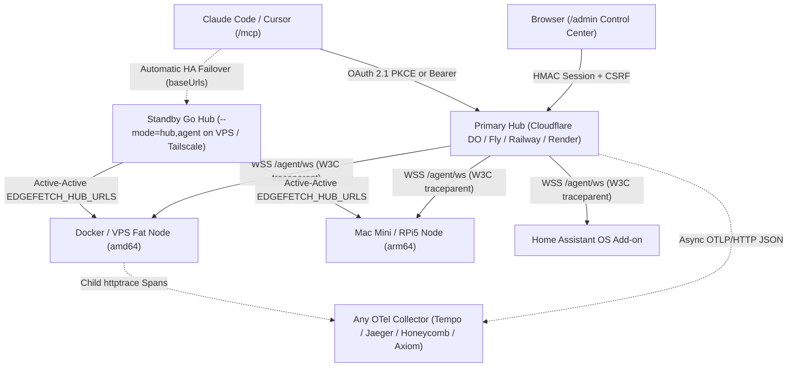

# EdgeFetch

[](https://github.com/bartrumb/edgefetch/actions/workflows/ci.yml)
[](go.mod)
[](https://pkg.go.dev/github.com/bartrumb/edgefetch/v2)
[](LICENSE)
[-0ea5e9.svg)](hub/LICENSE)

**EdgeFetch** is a self-hosted web scraping and search server for AI agents — **open-source worker, SDKs, and adapters ([MIT](LICENSE))** with a **fair-source hub ([FSL-1.1](hub/LICENSE), MIT after two years)**. You run one ~8 MB Go binary on any box you own (a Raspberry Pi, your Home Assistant, a spare laptop), and your agents get clean Markdown and structured data through MCP — with **zero open ports**, **zero Redis or Postgres**, and **no per-page bill**.

> Built for the agent web: user-triggered, never trains, signs its requests with Web Bot Auth, asks for Markdown first, honours `robots.txt` and Content Signals, and treats `402` as a price, not an error.

<p align="center">
  
</p>

## Try It in 60 Seconds

```bash
# Option 1 — Full 17-Tool Federated MCP Hub + Sign in with GitHub + BYO-LLM /v1/agent + 56 Site/ATS/Commerce Adapters + /admin UI + FTS5 in Docker (zero cloud account):
git clone https://github.com/bartrumb/edgefetch.git && cd edgefetch
export CALLER_TOKEN="$(openssl rand -hex 24)" AGENT_TOKEN="$(openssl rand -hex 24)" VAULT_MASTER_KEY="$(openssl rand -hex 24)"
docker compose up --build -d
# Open http://127.0.0.1:8787/admin and sign in with $CALLER_TOKEN (or configure GITHUB_CLIENT_ID / GITHUB_CLIENT_SECRET)

# Option 2 — Standalone ~8 MB Local Go Binary for Claude Code, Claude Desktop, Cursor, Windsurf, Gemini CLI & Codex (zero containers/ports):
brew install bartrumb/tap/edgefetch
# or with Go: go install github.com/bartrumb/edgefetch/v2/cmd/edgefetch@latest
edgefetch init && edgefetch doctor && edgefetch update --check
```

<p>
  <a href="https://deploy.workers.cloudflare.com/?url=https://github.com/bartrumb/edgefetch/tree/main/hub">
    
  </a>
  &nbsp;
  <a href="https://render.com/deploy?repo=https://github.com/bartrumb/edgefetch">
    
  </a>
  &nbsp;
  <a href="https://railway.com/new/github/bartrumb/edgefetch">
    
  </a>
  &nbsp;
  <a href="https://console.deno.com/new?clone=https://github.com/bartrumb/edgefetch&entrypoint=hub/portable/deno-server.ts">
    
  </a>
  &nbsp;
  <a href="https://my.home-assistant.io/redirect/supervisor_add_addon_repository/?repository_url=https%3A%2F%2Fgithub.com%2Fbartrumb%2Fedgefetch">
    
  </a>
</p>

## What Stands Out

- **Outbound-only workers with zero open ports (inbound LAN invisibility):** Workers on a Raspberry Pi, NAS, or Home Assistant box behind CGNAT/Starlink dial *out* over TLS WebSockets (`WSS /agent/ws`) to your Hub (`AGENT_TOKEN` per site; OAuth 2.1 PKCE + CSRF for MCP/`/admin` callers). Your home router and local LAN remain completely unreachable from the internet *(note: outbound fetches originate from your worker node's WAN IP, or from Cloudflare's edge IP when using `target: "cloudflare"`).*
- **Dial-time SSRF protection (including the browser):** `politeness.RejectNonPublicPeer` checks resolved peer IPs inside Go's `net.Dialer.Control` right before `connect()` (blocking DNS-rebinding TOCTOU), and headless Chromium subresources are forced through an in-process loopback `CONNECT` proxy (`--host-resolver-rules=MAP * ~NOTFOUND`).
- **Polite by design — with actionable `blocked.suggestion` rerouting:** `robots.txt` and `Content-Signal: ai-input` are enforced on every hop (including `30x` redirects), `Retry-After` is honored per host, HTTP `402` (`x402`) halts immediately as `payment_required` without auto-paying, anti-bot challenges (Cloudflare, Akamai, DataDome, PerimeterX, AWS WAF, Imperva) halt on the first attempt, and IETF RFC 9421 Web Bot Auth (`Ed25519` HTTP Message Signatures) is built in. When a path is blocked by `robots.txt` or a WAF, EdgeFetch returns a structured **`blocked.suggestion`** steering your agent to official public JSON boards, registries, or APIs (e.g., Greenhouse/Ashby/Workday CXS instead of LinkedIn, or Overpass/Nominatim instead of OSM `/api/`).
- **Clean Two-Plane Architecture (Pure Go Edge Engine & Hub + Serverless V8 Hub):**
  - **Go Data Plane & Standalone Hub (`cmd/`, `internal/` — 1 external Go module `coder/websocket`, `0` transitive deps, `~8 MB` static binary):** Runs 100% standalone with **zero TypeScript/Node** (`edgefetch scrape`, `edgefetch mcp` over `stdio`, `edgefetch update` Ed25519-verified self-updater, or `edgefetch --mode=hub` with embedded declarative site adapters!) *or* as an outbound worker daemon, handling every untrusted socket, dial-time SSRF check, 100% RFC 9309 `robots.txt` check, streaming PDF parse, and CDP Chromium session.
  - **Cloudflare / Portable Fair-Source Hub Plane (`hub/` — 6 vetted runtime packages: `re2js`, `htmlparser2`, `jose`, `oauth4webapi`, `ws`, `yaml`):** Optional full-featured fleet & MCP federation coordinator running natively on Cloudflare Hibernating WebSocket Durable Objects + D1 FTS5 + R2 (`$0` idle) or self-hosted `node:sqlite` (`dist/portable-server.mjs`, `0` runtime `node_modules` in containers). Combines **Sign in with GitHub** (`oauth4webapi` OAuth 2.1 PKCE + `jose` HS256 sessions) with strict `user_id` multi-user tenant isolation, a built-in **`/admin` MCP Registry & `AES-256-GCM` Connector Vault** (`HKDF-SHA256` per-user/per-origin keys + downstream OAuth 2.1 PKCE auto-refresh), **federated `discover_mcps` + `query_mcp` MCP-first routing** (calling official connected MCP servers before HTML scraping with zero prompt-schema bloat), Google RE2 linear-time regex safety (`re2js`), WHATWG HTML5 CSS-selector extraction (`parseHtmlDoc` via `htmlparser2`), RFC 6455 WebSocket framing (`ws`), and 56 MIT-licensed declarative YAML site/ATS/commerce adapters (`internal/extract/manifests/*.yaml`, `hub/src/extractors/`).
- **17 MCP tools + Federated MCP Connectors + 56 keyless site, commerce, open-data & ATS adapters + Autonomous BYO-LLM `/v1/agent`:** 17 MCP tools (`agent`, `discover_mcps`, `query_mcp`, `find_extractors`, `scrape`, `extract`, `map`, `crawl`, `search`, `jobs`, `catalog`, `search_collection`, `interact`, `read_artifact`, `fetch_url`, `fetch_batch`, `list_agents`), drop-in Firecrawl `/v2/*` compatibility, linear `64 KiB` framework detection, polite full-store **Shopify** (custom domains + `/products.json`) & **WooCommerce** inventory catalogs with variant diffs, and Claude-style dynamic MCP-first + adapter routing across **Workable**, **Greenhouse (US/EU)**, **Ashby**, **Lever (US/EU)**, **Workday CXS**, **iCIMS**, **Rippling**, **Gem**, **Pinpoint**, **Teamtailor**, **BambooHR**, **Oracle HCM**, **SmartRecruiters**, **SEC EDGAR**, **Y Combinator**, **Socrata / CKAN / ArcGIS / Legistar Open Data**, **DOI/Crossref**, **OpenAlex**, **arXiv**, **ClinicalTrials.gov**, **PubMed**, **NIST NVD**, **GitHub**, **Stack Overflow**, **npm**, **crates.io**, **Hugging Face**, **OpenRouter**, and **256 MiB streaming PDFs** — supporting offline local LLMs (**Ollama**, **LM Studio**, **vLLM**) or online BYO-LLM (**OpenAI**, **Anthropic**, **Gemini**, **OpenRouter**, **Workers AI**) with live SSE streaming and `$0` Zero Data Retention. Add a new adapter in one file via `npm run adapter:new` (**[docs/ADAPTERS.md](docs/ADAPTERS.md)**).

> **Project status:** Young personal project (started November 2026), running daily as the sole web/search layer on the author's 3-node fleet (Home Assistant OS `x86_64`, Windows VM, and `arm64`). Open-source worker, SDKs, and adapters ([MIT](LICENSE)); fair-source hub ([FSL-1.1-MIT](hub/LICENSE), MIT after two years). Issues and PRs are **triaged weekly**. See **[docs/LAUNCH-FAQ.md](docs/LAUNCH-FAQ.md)** for honest trade-offs.

---

## Head-to-Head vs. Other AI Crawlers & MCP Servers

Full architectural & trade-off breakdown: **[docs/COMPARISON.md](docs/COMPARISON.md)** · Common questions: **[docs/LAUNCH-FAQ.md](docs/LAUNCH-FAQ.md)**

| Dimension | **EdgeFetch (`v2.7`)** | **Firecrawl (Self-Hosted)** | **Firecrawl / Tavily (Cloud)** | **Crawl4AI** | **Jina Reader** |
|---|---|---|---|---|---|
| **License** | **Open-source worker, SDKs & adapters (`MIT`); fair-source hub (`FSL-1.1`, `MIT` after 2 yrs)** | AGPL-3.0 (core) | Proprietary SaaS | Apache-2.0 (+ attribution) | Apache-2.0 |
| **Minimum Self-Hosted Stack** | **1 `~8 MB` Go binary** *or* **1 container** (`node:sqlite` + `/data`, **0 Redis, 0 Postgres**) | Docker Compose + **Redis + PostgreSQL + RabbitMQ + Playwright** (`2–4 GB+` RAM) | Cloud API key | Python 3.10+ + Playwright (`600 MB–1.5 GB` RAM) | Node.js + Puppeteer |
| **Worker Supply Chain** | **1 Go module (`coder/websocket`, 0 transitive deps)** | Dozens of npm + OS deps | Vendor SaaS | 40+ PyPI packages | Dozens of npm deps |
| **Zero-Port Outbound Home/Edge Fleet (`WSS`)** | **Yes — Home Assistant OS, NAS, RPi, Mac/PC behind CGNAT/Starlink** | No (needs open ports, VPN, or paid residential proxies) | Paid proxy credits | No (single-host or DIY queue) | No |
| **Desktop `stdio` MCP (`edgefetch mcp`)** | **Yes — `~8 MB` binary uses pre-installed OS Edge/Chrome/Brave (0 ports, 0 300 MB browser download)** | Requires cloud key or full Docker stack | Cloud API key required | Python + Playwright setup | Cloud URL or Node server |
| **DNS-Rebinding SSRF + Browser Subresource Guard** | **Dial-time `RejectNonPublicPeer` + loopback `CONNECT` `SSRFProxy` (`MAP * ~NOTFOUND`)** | Application URL blocklist | Vendor-managed | Optional / app-level | App-level |
| **Web Search (`search` tool)** | **Bring your own Serper/Brave/Tavily keys, or SearXNG + `edge-map` + D1 FTS5 for `$0`** | Proprietary / SearXNG | Separate SaaS plans | Bring-your-own | `s.jina.ai` |
| **OpenTelemetry (`OTLP/HTTP` + W3C `traceparent`)** | **Stitched Hub → Go `httptrace` (`dnsMs`, `connectMs`, `tlsMs`, `ttfbMs`) to any collector** | Internal logs / BullMQ | Vendor dashboard only | Python logs | Internal logs |
| **Typical Cost (50k scrapes + 5k searches / mo)¹** | **`$0 – $5 / mo`** (Cloudflare Hibernating DO + homelab + SearXNG) | `$25 – $80+ / mo` (VPS + proxy GBs) | `$49 – $130+ / mo` | `$10 – $40+ / mo` (VPS + proxies) | Credit-metered |

*¹ Cost assumptions checked Nov 20, 2026: compares Cloudflare Workers Free (`$0`) or Paid (`$5/mo`) within R2 (`10 GB`) and D1 (`5 GB`) monthly free tiers plus self-hosted SearXNG (`$0`, using existing home/VPS compute) against published Firecrawl Standard (`$19–$99/mo`) + Tavily Researcher (`$30+/mo`) plans.*

---

## Architecture & High-Availability Mesh



---

## Deployment Modes in Detail

### Option A: Standalone Worker Container (Linux, macOS, Windows, NAS, RPi, or VPS)

Multi-arch OCI manifests (`linux/amd64` + `linux/arm64`) run as non-root `65532:65532`:

```bash
# Full "Fat" Agent (Go HTTP/2 + SSRF-proxied Headless Chromium + SwiftShader + Poppler PDF):
docker run -d --name edgefetch-agent --restart=unless-stopped \
  --security-opt no-new-privileges:true \
  -e EDGEFETCH_HUB_URL=https://<your-hub-domain> \
  -e EDGEFETCH_AGENT_TOKEN="<YOUR_AGENT_TOKEN>" \
  -e EDGEFETCH_SITE_ID="node-1" \
  ghcr.io/bartrumb/edgefetch-agent:latest

# Or Ultra-Light ~9 MB Distroless Agent (HTTP/2 + Markdown + pure-Go PDF, ~15 MB RAM):
docker run -d --name edgefetch-lite --restart=unless-stopped --read-only \
  -e EDGEFETCH_HUB_URL=https://<your-hub-domain> \
  -e EDGEFETCH_AGENT_TOKEN="<YOUR_AGENT_TOKEN>" \
  -e EDGEFETCH_SITE_ID="lite-1" \
  ghcr.io/bartrumb/edgefetch-agent:lite --mode=agent
```

### Option B: Desktop CLI, `stdio` MCP, Self-Hosted Go Hub & Bot Auth Keygen

Download a release archive from [GitHub Releases](https://github.com/bartrumb/edgefetch/releases) or install with `go install`:

```bash
go install github.com/bartrumb/edgefetch/v2/cmd/edgefetch@latest

# Auto-configure zero-daemon, zero-port stdio MCP into Claude Desktop & Cursor:
edgefetch install-mcp

# Verify Ed25519-signed updates or self-update binary in place, and run diagnostics:
edgefetch update --check
edgefetch doctor
edgefetch scrape https://example.com
edgefetch scrape --json --query="installation" https://developers.cloudflare.com/workers/

# Optional: mint an IETF RFC 9421 Ed25519 Web Bot Auth signing keypair:
edgefetch keygen-bot-auth

# Or run a 100% self-hosted Go WebSocket Hub + /v1/scrape + /mcp controller on a small VPS:
EDGEFETCH_CALLER_TOKEN="<32-char-secret>" EDGEFETCH_AGENT_TOKEN="<32-char-secret>" \
  edgefetch --mode=hub --addr=0.0.0.0:8080
```

### Option C: Cloud Hub (Cloudflare Workers, Render, Railway, Fly.io) & Home Assistant OS

1. **Cloudflare Workers (`$0` idle):** Click **Deploy to Cloudflare** above (or `cd hub && npm ci && npx wrangler deploy`).
2. **Render / Railway / Fly.io (Single All-in-One Container + Persistent `/data` Volume):** Use [`render.yaml`](render.yaml), [`railway.json`](railway.json), or `fly launch --copy-config` ([`fly.toml`](fly.toml)).
3. **Home Assistant OS (`amd64` & `aarch64`):** Click **Add Repository to Home Assistant** above, install **EdgeFetch**, set `hub_url`, `agent_token`, and `site_id`, and click **Start**.

---

## Feature & Extraction Highlights (`v2.7`, `SCRAPE_PIPELINE_VERSION = 30`)

- **25+ Site & ATS Job-Board Extractors ([`hub/src/extractors/registry.ts`](hub/src/extractors/registry.ts), [`hub/src/jobs.ts`](hub/src/jobs.ts)):**
  - **ATS Job Boards & Structured `jobs` Tool:** One-call job search & extraction across **Greenhouse**, **Ashby** (`?includeCompensation=true`), **Lever**, **Workday CXS** (`GET` & `POST`), and **SmartRecruiters / Schema.org `JobPosting` JSON-LD**, normalizing pay (`{ min, max, currency, period, basis: "base"|"ote"|"total" }`) and filtering out closed postings (`contentState: "closed_posting"`).
  - **Developer & Research Sites:** 1-hop JSON/raw/patch upgrades for **GitHub** (raw, `.patch`, Issues/PRs, Gist), **GitLab**, **Codeberg**, **Stack Overflow** (`✅ Accepted Answer`), **npm**, **crates.io**, **Hugging Face** (YAML model cards → GFM tables), **Discourse**, **Lobsters**, **Reddit**, **Bluesky** (ATProto), **Mastodon**, **DEV.to**, **pkg.go.dev**, **PyPI**, **Wikipedia**, **IETF RFCs**, **ArXiv**, **PubMed/PMC**, **Hacker News**, and **YouTube transcripts**.
- **Data-Gathering & SPA Reliability:**
  - **Native CDP SPA Engine (`internal/browser/renderer.go`):** Tracks real CDP `Network.requestWillBeSent` / `loadingFinished` XHR/Fetch `networkidle`, triggers `IntersectionObserver` lazy-load scroll passes, waits on a `MutationObserver` DOM quiescence check, and flattens open Web Component `shadowRoot` trees.
  - **SSR Hydration Recovery (Next.js App Router `self.__next_f.push` RSC, `__NEXT_DATA__`, Nuxt 3 `__NUXT_DATA__`, Remix, Apollo):** Recovers full prose from thin SPA shells in 1 HTTP hop before launching Chromium.
  - **Optional Ethical Heavy-SPA Fallback (`Crawl4AI` & `Firecrawl` — Cloud or Self-Hosted):** Configure `CRAWL4AI_API_URL` and/or `FIRECRAWL_API_URL` + `FIRECRAWL_API_KEY` so heavy SPAs (or Lite-only fleets without local Chromium) fall back automatically after verifying `robots.txt` — while **never** delegating `robots.txt` blocks, `401`/`403`/`429`, or anti-bot challenges.
  - **Conditional `304 Not Modified` Revalidation:** Sends stored `ETag` / `Last-Modified` validators from `META` D1 and serves verified R2 Markdown immediately on `304`.
  - **7-Vendor WAF Catalog + 4 Anti-False-Positive Layers:** Accurately classifies Cloudflare, Akamai, DataDome, PerimeterX, AWS WAF, Imperva, and Vercel/Fastly/Kasada challenges while stripping `<pre><code>` / `<blockquote>` and vetoing `200 OK` articles (`>= 250` words, JSON-LD, `<nav>`) so security/Turnstile docs never false-positive.
  - **Opt-in `waybackFallback`:** Recovers `5xx` / DNS-dead link rot from the Internet Archive (never invoked on `robots.txt`, `403`/`429`, or challenges).
  - **Token Efficiency:** **`-91.6%` LLM token reduction** on our offline **8-fixture synthetic regression corpus** (**[bench/RESULTS.md](bench/RESULTS.md)**), preserving `<T>` generics (`Promise<void>`), GFM tables, KaTeX math, `.ipynb` outputs, and OpenAPI 3.x schemas.

---

## Tested & Supported Platforms Matrix

Status legend:
- **✅ Daily-Driver + CI Verified:** Running daily on the author's 3-node personal fleet (`arm64`, Home Assistant OS `x86_64`, and Windows VM) since Nov 18, 2026 *and* gated by automated E2E / smoke suites on every PR.
- **✅ Live-Tested + CI Verified:** Executed end-to-end on real host OS/runtime during verification *and* covered by automated CI tests.
- **🔧 Build & Manifest Verified:** Static `CGO_ENABLED=0` cross-compilation (`go build` / GoReleaser) and deployment manifests verified cleanly; community hardware reports welcome!

| Platform / Target | Role(s) | Binary / Image Footprint | Capabilities | Verification Status |
|---|---|---|---|---|
| **Cloudflare Workers + Hibernating DO + D1 (FTS5) + R2 + Workflows** | Cloud Hub (`/mcp`, `/admin`, GitHub OAuth + OAuth 2.1, `AES-256-GCM` MCP Vault) | Serverless bundle (`~450 KB` gzip) | 17-tool Federated MCP, Search, FTS5, R2 Artifacts, RFC 9421, OTLP | **✅ Daily-Driver + CI Verified** (`workerd` `H7` & `S1` suites) |
| **Home Assistant OS (`amd64` x86_64 & `aarch64` RPi / NUC / VM)** | Outbound Home Worker (`edgefetch_fat`) | Multi-arch Alpine + Chromium + SwiftShader + Poppler | HTTP/2, `artifacts-v1`, `browser-v1`, `interact-v1`, 256 MiB PDF | **✅ Daily-Driver + CI Verified** (`x86_64` & `arm64` home nodes) |
| **Windows 11 (`windows/amd64` Desktop & VM)** | Local `stdio` MCP, `desktop` Launchpad, CLI & Fleet Worker | `~8 MB` (`edgefetch.exe`, `0` DLL deps) | Auto-detects native Windows **Chrome / Edge / Brave** for CDP JS render | **✅ Daily-Driver + CI Verified** (Windows VM node + CLI E2E) |
| **Linux Docker Worker — Fat (`linux/amd64`, `linux/arm64`)** | Standalone Worker (`Dockerfile.agent`) | Non-root `65532:65532` + AppArmor + Chromium WebGL | Full HTTP/2 + SSRF-proxied Headless Chromium + Poppler PDF | **✅ Live-Tested + CI Verified** (live AppArmor + WebGL CI smoke) |
| **Linux Distroless Worker/Server — Lite (`linux/amd64`, `linux/arm64`)** | Ultra-light Worker / Server / Go Hub (`Dockerfile`) | `~8 MB` static binary (`~15 MiB` RAM) | HTTP/2, Markdown, pure-Go PDF, `--mode=hub`, RFC 9421, OTLP | **✅ Live-Tested + CI Verified** (`buildx` multi-arch CI) |
| **All-in-One Container (`Dockerfile.all-in-one` / Docker Compose)** | Full TypeScript Hub + `node:sqlite` FTS5 + Go Chromium Worker | Node 26 Alpine + Go + Chromium + Poppler (`0` Redis, `0` Postgres) | `/admin`, OAuth 2.1, `/mcp`, SQLite FTS5, `/data` artifacts, JS render | **✅ Live-Tested + CI Verified** (`V2-9` E2E + `buildx` CI) |
| **Linux (`ubuntu/wsl2` `linux/amd64`)** | `--mode=hub`, `--mode=hub,agent` HA Mesh, CLI (`scrape`, `doctor`) | `~8 MB` static ELF | Active-active `EDGEFETCH_HUB_URLS`, Go Hub `/mcp`, `Fuzz*`, `-race` | **✅ Live-Tested + CI Verified** (Go 1.27 `-race` + `govulncheck`) |
| **WebAssembly / WASI (`wasip1/wasm`)** | Sandboxed Offline HTML → Markdown / JSON Extractor | [`cmd/edgefetch-wasm`](cmd/edgefetch-wasm/main.go) (`make build-wasm`) | Runs inside `wasmtime`, `wazero`, or Wasm sandboxes | **✅ Live-Tested + CI Verified** (`go build` + unit test) |
| **Chrome / Firefox Manifest V3 Extension** | Active-Tab FTS5 Clipper (`POST /v1/ingest-tab`) | [`extensions/browser-clipper/`](extensions/browser-clipper/manifest.json) | Clips authenticated tabs ethically into private FTS5 collections | **✅ Live-Tested + CI Verified** (`V2-11` E2E) |
| **Deno Deploy + Turso HTTP + S3 SigV4** | Serverless Hub Adapter | [`hub/portable/deno-server.ts`](hub/portable/deno-server.ts), [`s3-bucket.ts`](hub/portable/s3-bucket.ts), [`turso-d1.ts`](hub/portable/turso-d1.ts) | Zero-dep WebCrypto SigV4 (S3/R2/Tigris/MinIO/B2) + Turso `/v2/pipeline` | **✅ Live-Tested + CI Verified** (`V2-11` unit + `tsc`) |
| **macOS Apple Silicon & Intel (`darwin/arm64`, `darwin/amd64`)** | Local `stdio` MCP, `desktop` Launchpad, CLI & Worker | `~7.5–8 MB` static binary | Auto-detects `/Applications/Google Chrome.app`, Edge & Brave | **🔧 Build & Manifest Verified** ([`.goreleaser.yaml`](.goreleaser.yaml)) |
| **Windows on ARM (`windows/arm64`)** | Desktop CLI, `stdio` MCP & Worker | `~7.5 MB` (`edgefetch.exe`) | HTTP/2, Markdown, pure-Go PDF, OS Edge/Chrome detection | **🔧 Build & Manifest Verified** ([`.goreleaser.yaml`](.goreleaser.yaml)) |
| **Fly.io / Railway / Render / Coolify** | 1-Click Cloud Self-Hosted All-in-One Hub + Worker | [`fly.toml`](fly.toml), [`railway.json`](railway.json), [`render.yaml`](render.yaml) | Persistent `/data` SQLite FTS5 + artifacts + Headless Chromium | **🔧 Build & Manifest Verified** (runs `Dockerfile.all-in-one`) |
| **Kubernetes (`amd64` / `arm64` Clusters)** | Zero-Trust Fleet Worker Pod | [`deploy/k8s/agent-deployment.yaml`](deploy/k8s/agent-deployment.yaml) | Read-only rootfs, `seccomp: RuntimeDefault`, `NetworkPolicy` (`ingress: []`) | **🔧 Build & Manifest Verified** |
| **Unraid, CasaOS, Portainer, Synology, Proxmox LXC & Termux** | Homelab / NAS / LXC / Spare-Phone Worker | [`deploy/`](deploy/), [`compose.agent.yaml`](compose.agent.yaml) | Outbound `WSS` node (zero port forwarding) | **🔧 Build & Manifest Verified** |
| **OpenWrt (`linux/mipsle`, `armv7`) & FreeBSD (`freebsd/amd64`, `arm64`)** | Router / Firewall Appliance Lite Worker | `~7.5–8.5 MB` static binary | HTTP/2, Markdown, pure-Go PDF (`CGO_ENABLED=0`) | **🔧 Build & Manifest Verified** ([`.goreleaser.yaml`](.goreleaser.yaml)) |

---

## Reproducible Go Hot-Path Microbenchmarks

Run `go test -bench=. -benchmem ./...` locally:

| Go Benchmark (`go test -bench=. -benchmem ./...`) | Latency | Heap Allocations |
|---|---:|---:|
| `BenchmarkParseRetryAfter` | `4.45 ns/op` | **`0 B/op` (`0 allocs/op`)** |
| `BenchmarkRobotsMatch` (`*` wildcards + `$` anchor) | `52.17 ns/op` | **`0 B/op` (`0 allocs/op`)** |
| `BenchmarkIsPublicIP` (IPv4 + NAT64 IPv6 check) | `155.50 ns/op` | **`0 B/op` (`0 allocs/op`)** |
| `BenchmarkClassifyFeedJSON` | `1,229 ns/op` | `1,416 B/op` (`28 allocs/op`) |

---

## Documentation & Contributing

- **Launch & Architecture FAQ:** **[docs/LAUNCH-FAQ.md](docs/LAUNCH-FAQ.md)**
- **Head-to-Head Comparison & Trade-Offs:** **[docs/COMPARISON.md](docs/COMPARISON.md)**
- **Synthetic Extraction Benchmark (`-91.5%` tokens on 8 fixtures):** **[bench/RESULTS.md](bench/RESULTS.md)**
- **Site Adapter Authoring Guide (YAML Manifests, `parseHtmlDoc` & `adapter:test`):** **[docs/ADAPTERS.md](docs/ADAPTERS.md)**
- **Operations, OTLP Tracing, HA Mesh & MCP Guide:** **[docs/USAGE.md](docs/USAGE.md)**
- **Hub ↔ Go Agent Wire Protocol Spec:** **[docs/PROTOCOL.md](docs/PROTOCOL.md)**
- **Systems & Go Concurrency Internals:** **[docs/INTERNALS.md](docs/INTERNALS.md)**
- **Security Threat Model, Signed Releases & SSRF Controls:** **[SECURITY.md](SECURITY.md)**
- **Bot, WAF & MCP Registry Certification Guide:** **[docs/REGISTRATION.md](docs/REGISTRATION.md)**
- **Contributing Rules & Code of Conduct:** **[CONTRIBUTING.md](CONTRIBUTING.md)** · **[CODE_OF_CONDUCT.md](CODE_OF_CONDUCT.md)**

## License & Trademarks

EdgeFetch uses an **open-source worker, SDKs, and adapters / fair-source hub** license split:

- **Open-Source Worker, CLI, SDKs & All Site Adapters (`cmd/`, `internal/`, `sdk/`, `extensions/`, `internal/extract/manifests/`, `hub/src/extractors/`):** **[MIT](LICENSE)** (and [`hub/src/extractors/LICENSE`](hub/src/extractors/LICENSE)).
- **Fair-Source Hub (`hub/`, excluding `hub/src/extractors/`):** **[FSL-1.1-MIT](hub/LICENSE)** (*Functional Source License 1.1, MIT after two years*) — free to read, modify, and self-host personally or internally within your organization; third parties may not offer the Hub as a competing commercial hosted/managed service, and each release converts to `MIT` two years after publication.
- **Contributions:** Inbound = `MIT` + DCO sign-off (`git commit -s`), per **[CONTRIBUTING.md](CONTRIBUTING.md)**.

**Trademarks:** **EdgeFetch™** and the EdgeFetch raven logo are trademarks of Brett Bartrum. Neither the MIT License nor the Functional Source License grants permission to use the EdgeFetch name, `edgefetch.dev` domain, or project logos to brand, endorse, or market a third-party product or hosted service.
