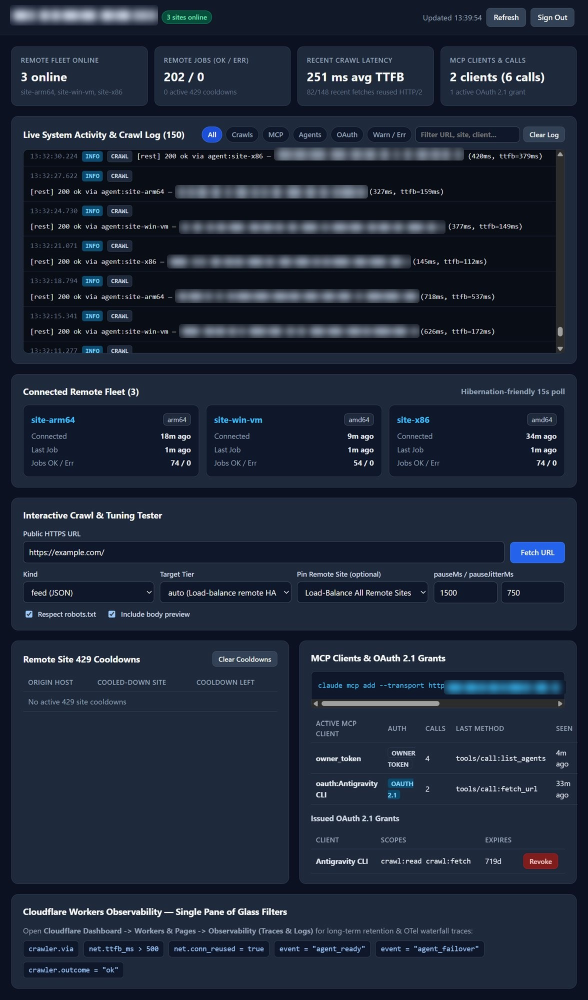
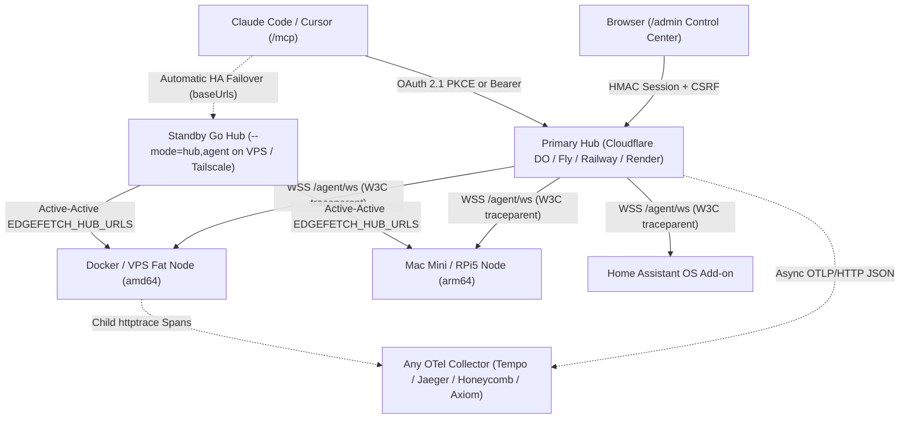

# EdgeFetch

[](https://github.com/bartrumb/edgefetch/actions/workflows/ci.yml)
[](go.mod)
[](https://pkg.go.dev/github.com/bartrumb/edgefetch)
[](LICENSE)

<p>
  <a href="https://deploy.workers.cloudflare.com/?url=https://github.com/bartrumb/edgefetch/tree/main/hub">
    
  </a>
  &nbsp;
  <a href="https://render.com/deploy?repo=https://github.com/bartrumb/edgefetch">
    
  </a>
  &nbsp;
  <a href="https://railway.com/new/github/bartrumb/edgefetch">
    
  </a>
  &nbsp;
  <a href="https://fly.io/docs/hands-on/launch-app/">
    
  </a>
  &nbsp;
  <a href="https://console.deno.com/new?clone=https://github.com/bartrumb/edgefetch&entrypoint=hub/portable/deno-server.ts">
    
  </a>
  &nbsp;
  <a href="https://my.home-assistant.io/redirect/supervisor_add_addon_repository/?repository_url=https%3A%2F%2Fgithub.com%2Fbartrumb%2Fedgefetch">
    
  </a>
  &nbsp;
  <a href="https://vscode.dev/redirect/mcp/install?name=edgefetch&config=%7B%22command%22%3A%22edgefetch%22%2C%22args%22%3A%5B%22mcp%22%5D%7D">
    
  </a>
</p>

**EdgeFetch** (`v2.2`) is a self-hosted **scrape, map, crawl, extract, interact, and search** platform for AI agents — deployable on **Cloudflare Workers**, **Deno Deploy**, **Fly.io**, **Railway**, **Render**, **Docker Compose**, or **a single ~8 MiB static Go binary**, paired with **outbound-only Go worker nodes** (`amd64` & `arm64` Docker, Home Assistant OS, Proxmox LXC, Raspberry Pi, NAS, Android Termux, or VPS) with HTTP/2, SSRF-proxied Headless Chromium, and streaming Poppler PDF.

Unlike self-hosted Firecrawl (which requires Redis, PostgreSQL, RabbitMQ, and a separate Playwright cluster under AGPL-3.0), EdgeFetch is **MIT-licensed**, uses **one external Go dependency (`coder/websocket`, zero transitive dependencies)**, opens **zero inbound router ports** on worker nodes, exports **vendor-agnostic OpenTelemetry (`OTLP/HTTP` + W3C `traceparent`)** traces to any collector, and idles near **$0/month** on Cloudflare Hibernating WebSocket Durable Objects or a single container.

<p align="center">
  
</p>

---

## Why EdgeFetch?

- **Minimal Go Supply Chain (One Dependency, Zero Transitive Dependencies):** HTTP/2 connection pooling, `net/http/httptrace` phase telemetry, zero-allocation RFC 9309 `robots.txt` matching, RFC 9110 `Retry-After` parsing, three-state circuit breaking, OpenTelemetry OTLP/HTTP trace export, and Linux `prctl` + `setuid` privilege dropping use the Go standard library plus `github.com/coder/websocket` — verified continuously under `-race` and native Go fuzzing (`Fuzz*`).
- **Run Anywhere — Multi-Edge, All-in-One Container, or Pure Go Controller (`--mode=hub`):**
  - **Cloudflare Hub (`hub/`):** Hibernating WebSocket Durable Object (`AgentHubDO`) + optional R2 + D1 + D1 FTS5 (`~$0` idle cost).
  - **All-in-One Portable Container (`Dockerfile.all-in-one`):** Runs the full TypeScript Hub (`/admin`, OAuth 2.1, 11-tool `/mcp`, `node:sqlite` FTS5, `/data` artifacts) + local Go Chromium/Poppler worker in **one container** on Fly.io (`fly.toml`), Railway (`railway.json`), Render (`render.yaml`), Coolify, or `docker compose up` — zero Postgres, zero Redis.
  - **Pure Go Controller & HA Mesh (`edgefetch --mode=hub` / `--mode=hub,agent`):** The exact same ~9 MB static Go binary can act as a central WebSocket controller (`/agent/ws`, `/v1/scrape`, `/fetch`, `/mcp`), an outbound worker (`--mode=agent` with active-active `EDGEFETCH_HUB_URLS` multi-controller fan-out), or a hybrid Tailscale/LAN standby controller (`--mode=hub,agent`).
- **Best-of-Breed Open-Source Extraction (`SCRAPE_PIPELINE_VERSION = 20`, `-91.6%` LLM Token Reduction):**
  - Modular **20+ Platform Site Extractor Registry** ([`hub/src/extractors/registry.ts`](hub/src/extractors/registry.ts)): 1-hop JSON/raw/patch upgrades & DOM extractors for **npm**, **crates.io**, **Hugging Face** (YAML model cards → GFM tables), **GitHub** (raw, `.patch`, Issues/PRs, Gist), **GitLab**, **Codeberg**, **Stack Overflow / Stack Exchange** (`✅ Accepted Answer`), **Discourse** (`/t/<slug>/<id>.json`), **Lobsters**, **Reddit**, **Bluesky** (ATProto), **Mastodon**, **DEV.to**, **pkg.go.dev**, **PyPI**, **RubyGems**, **Packagist**, **Hex.pm**, **JSR**, **Wikipedia**, **IETF RFCs**, **ArXiv**, **PubMed/PMC**, **Hacker News**, **Substack**, and **YouTube transcripts**.
  - Sentinel-protected `<pre><code>` & multi-backtick inline `<code>` conversion preserves generic types (`Promise<void>`, `#include <stdio.h>`), GFM tables, footnotes (`[^1]`), `<figure>/<figcaption>`, callouts (`> [!NOTE]`), LaTeX math, **Jupyter `.ipynb`**, **OpenAPI 3.x**, **CSV/TSV**, **RSS/Atom**, **`.ics`**, **`.vcf`**, and **256 MiB streaming Poppler PDFs** — benchmarked in **[bench/RESULTS.md](bench/RESULTS.md)**.
- **11-Tool Dual-Era OAuth 2.1 MCP Server (`2026-07-28` & `2025-03-26`) + Firecrawl / Tavily Drop-In Compat:**
  - Exposes `list_agents`, `scrape`, `extract`, `map`, `crawl`, `search` (Serper + Brave + Tavily + SearXNG + `edge-map` + private D1 FTS5 fused via Reciprocal Rank Fusion with foreign locale deduplication), `search_collection`, `interact`, `read_artifact`, `fetch_url`, and `fetch_batch`, plus `/compat/firecrawl/v2/*`, `/compat/tavily/*`, and [`sdk/ts/edgefetch-client.ts`](sdk/ts/edgefetch-client.ts) (with `baseUrls` automatic multi-controller HA failover).
- **Vendor-Agnostic OpenTelemetry (`OTLP/HTTP` + W3C `traceparent`):**
  - Set `OTEL_EXPORTER_OTLP_ENDPOINT` + `OTEL_EXPORTER_OTLP_HEADERS` on Hub and/or Go nodes to stream stitched parent/child `httptrace` (`dnsMs`, `connectMs`, `tlsMs`, `ttfbMs`, `reused`) waterfalls directly to **Grafana Tempo**, **Jaeger**, **Honeycomb**, **Axiom**, **SigNoz**, or any OTLP collector at zero added caller latency.
- **Defense-in-Depth Security ([SECURITY.md](SECURITY.md)):**
  - Dial-time `net.Dialer.Control` SSRF guard (`RejectNonPublicPeer`) eliminates DNS-rebinding TOCTOU races; headless Chromium subresources are forced through an in-process loopback `SSRFProxy` (`CONNECT` + `MAP * ~NOTFOUND`); anti-bot/CAPTCHA pages halt immediately and are never bypassed.

---

## Head-to-Head vs. Other AI Crawlers & MCP Servers

Full architectural & extraction breakdown: **[docs/COMPARISON.md](docs/COMPARISON.md)**

| Dimension | **EdgeFetch (`v2.1`)** | **Firecrawl (Self-Hosted)** | **Firecrawl / Tavily (Cloud)** | **Crawl4AI** | **Jina Reader** |
|---|---|---|---|---|---|
| **License** | **MIT** | AGPL-3.0 (core) | Proprietary SaaS | Apache-2.0 (+ attribution) | Apache-2.0 |
| **Minimum Self-Hosted Stack** | **1 `~8 MiB` Go binary** *or* **1 container** (`node:sqlite` + `/data`, **0 Redis, 0 Postgres**) | Docker Compose + **Redis + PostgreSQL + RabbitMQ + Playwright** (`2–4 GB+` RAM) | Cloud API key | Python 3.10+ + Playwright (`600 MB–1.5 GB` RAM) | Node.js + Puppeteer |
| **Worker Supply Chain** | **1 Go module (`coder/websocket`, 0 transitive deps)** | Dozens of npm + OS deps | Vendor SaaS | 40+ PyPI packages | Dozens of npm deps |
| **Zero-Port Outbound Residential Fleet (`WSS`)** | **Yes — Home Assistant OS, NAS, RPi, Mac/PC behind CGNAT/Starlink** | No (needs open ports, VPN, or paid residential proxies) | Paid proxy credits | No (single-host or DIY queue) | No |
| **Desktop `stdio` MCP (`edgefetch mcp`)** | **Yes — `~8 MiB` binary uses pre-installed OS Edge/Chrome/Brave (0 ports, 0 300 MB browser download)** | Requires cloud key or full Docker stack | Cloud API key required | Python + Playwright setup | Cloud URL or Node server |
| **Active-Active Multi-Hub HA & Standby Mesh** | **Yes (`EDGEFETCH_HUB_URLS` + `HUB_SHARDS` DO ring + `--mode=hub,agent` + SDK `baseUrls`)** | Manual LB + Redis/Postgres HA | Single cloud vendor | Manual | Manual |
| **DNS-Rebinding SSRF + Browser Subresource Guard** | **Dial-time `RejectNonPublicPeer` + loopback `CONNECT` `SSRFProxy` (`MAP * ~NOTFOUND`)** | Application URL blocklist | Vendor-managed | Optional / app-level | App-level |
| **OpenTelemetry (`OTLP/HTTP` + W3C `traceparent`)** | **Stitched Hub → Go `httptrace` (`dnsMs`, `connectMs`, `tlsMs`, `ttfbMs`) to any collector** | Internal logs / BullMQ | Vendor dashboard only | Python logs | Internal logs |
| **Extraction Extras (`v19`)** | **Code-stash `<T>` safe, `/llms.txt` 1-hop `.md`, `.ipynb`, OpenAPI 3.x, 256 MiB PDF, YouTube captions, RRF Search** | Strong HTML/PDF + hosted verticals (`Alexandria`, `agent`) | Strong SaaS scrape *or* search (separate plans) | Strong `Pruning` + `BM25` | Good Markdown + `s.jina.ai` |
| **Typical Cost (50k scrapes + 5k searches / mo)** | **`$0 – $5 / mo`** (Cloudflare Hibernating DO + homelab/VPS) | `$25 – $80+ / mo` (VPS + proxy GBs) | `$49 – $130+ / mo` | `$10 – $40+ / mo` (VPS + proxies) | Credit-metered |

---

## Architecture & High-Availability Mesh



---

## Quickstart — Pick Your Deployment Mode

### Option A: 1-Command Standalone Worker Container (Any Linux, macOS, Windows, NAS, RPi, or VPS)

No Home Assistant required! Multi-arch OCI manifests (`linux/amd64` + `linux/arm64`) run as non-root `65532:65532`:

```bash
# Full "Fat" Agent (Go HTTP/2 + SSRF-proxied Headless Chromium + SwiftShader + Poppler PDF):
docker run -d --name edgefetch-agent --restart=unless-stopped \
  --security-opt no-new-privileges:true \
  -e EDGEFETCH_HUB_URL=https://<your-hub-domain> \
  -e EDGEFETCH_AGENT_TOKEN="<YOUR_AGENT_TOKEN>" \
  -e EDGEFETCH_SITE_ID="node-1" \
  ghcr.io/bartrumb/edgefetch-agent:latest

# Or Ultra-Light 9 MB Distroless Agent (HTTP/2 + Markdown + pure-Go PDF, ~15 MB RAM):
docker run -d --name edgefetch-lite --restart=unless-stopped --read-only \
  -e EDGEFETCH_HUB_URL=https://<your-hub-domain> \
  -e EDGEFETCH_AGENT_TOKEN="<YOUR_AGENT_TOKEN>" \
  -e EDGEFETCH_SITE_ID="lite-1" \
  ghcr.io/bartrumb/edgefetch-agent:lite --mode=agent
```

Or use [`compose.agent.yaml`](compose.agent.yaml): `docker compose -f compose.agent.yaml up -d`.

### Option B: Zero-Cloud Local Stack (`docker compose up` in 20 Seconds)

Spin up the full Hub (`/admin`, OAuth 2.1, 11-tool `/mcp`, SQLite FTS5, `/data` artifacts) + 2 local Go Chromium worker nodes (`local-node-1`, `local-node-2`) with **zero cloud account**:

```bash
git clone https://github.com/bartrumb/edgefetch.git
cd edgefetch
docker compose up --build -d
# Open http://localhost:8787/admin (default token: local-dev-caller-token-0123456789)
```

### Option C: Zero-Setup Desktop (`Win` / `macOS` / `Linux`) & Local `stdio` MCP

Download a single ~8 MB binary (auto-detects pre-installed **Windows Edge / Chrome / Brave** and **macOS Chrome / Edge / Brave** for full JS rendering — zero 300 MB Chromium download!) or install with `go install`:

```bash
go install github.com/bartrumb/edgefetch/cmd/edgefetch@latest

# 1. Auto-configure zero-daemon, zero-port stdio MCP into Claude Desktop & Cursor:
edgefetch install-mcp

# 2. Or launch the loopback Desktop Launchpad UI (http://127.0.0.1:8787 — also runs automatically when double-clicking edgefetch.exe!):
edgefetch desktop

# 3. Verify SSRF guard, loopback CONNECT proxy, OS Chrome/Edge & pdftotext, or scrape directly from terminal:
edgefetch doctor
edgefetch scrape https://example.com
edgefetch scrape --json --query="installation" https://developers.cloudflare.com/workers/

# 4. Run a 100% self-hosted Go WebSocket Hub + /v1/scrape + /mcp controller on a $4 VPS:
EDGEFETCH_CALLER_TOKEN="<32-char-secret>" EDGEFETCH_AGENT_TOKEN="<32-char-secret>" \
  edgefetch --mode=hub --addr=0.0.0.0:8080
```

### Option D: 1-Click Cloud Hub (Cloudflare Workers, Render, Railway, Fly.io) & Home Assistant OS

1. **Cloudflare Workers (`~$0` idle):** Click **Deploy to Cloudflare** at the top of this page (or `cd hub && npm ci && npx wrangler deploy`).
2. **Render / Railway / Fly.io (Single All-in-One Container + Persistent `/data` Volume):**
   - Click **Deploy to Render** ([`render.yaml`](render.yaml)) or **Deploy on Railway** ([`railway.json`](railway.json)), or run `fly launch --copy-config` ([`fly.toml`](fly.toml)).
3. **Home Assistant OS (`amd64` & `aarch64`):** Click **Add Repository to Home Assistant** above, install **EdgeFetch**, set `hub_url`, `agent_token`, and `site_id`, and click **Start**.

---

## Tested & Supported Platforms Matrix

Status legend:
- **✅ Production + CI Verified:** Running continuously in multi-site production fleets *and* gated by automated E2E / smoke suites on every pull request.
- **✅ Live-Tested + CI Verified:** Executed end-to-end on real host OS/runtime during release verification *and* covered by automated CI tests.
- **🔧 Build & Manifest Verified:** Static `CGO_ENABLED=0` binary cross-compilation (`go build`) and/or deployment manifests verified cleanly; community hardware reports welcome.

| Platform / Target | Role(s) | Binary / Image Footprint | Capabilities | Verification Status |
|---|---|---|---|---|
| **Cloudflare Workers + Hibernating DO + D1 (FTS5) + R2 + Workflows** | Cloud Hub (`/mcp`, `/admin`, OAuth 2.1, `HUB_SHARDS`) | Serverless bundle (`0` npm runtime deps) | 11-tool MCP, RRF Search, FTS5, R2 Artifacts, OTLP | **✅ Production + CI Verified** (`workerd` `H7` & `S1` suites) |
| **Home Assistant OS (`amd64` x86_64 & `aarch64` RPi / NUC / VM)** | Outbound Residential Worker (`edgefetch_fat`) | Multi-arch Alpine + Chromium + SwiftShader + Poppler | HTTP/2, `artifacts-v1`, `browser-v1`, `interact-v1`, 256 MiB PDF | **✅ Production + CI Verified** (multi-site residential fleet) |
| **Linux Docker Worker — Fat (`linux/amd64`, `linux/arm64`)** | Standalone Worker (`Dockerfile.agent`) | Non-root `65532:65532` + AppArmor + Chromium WebGL | Full HTTP/2 + SSRF-proxied Headless Chromium + Poppler PDF | **✅ Production + CI Verified** (live AppArmor + WebGL CI smoke) |
| **Linux Distroless Worker/Server — Lite (`linux/amd64`, `linux/arm64`)** | Ultra-light Worker / Server / Go Hub (`Dockerfile`) | `7.71 MiB` (`amd64`) / `7.13 MiB` (`arm64`) static binary (`~15 MiB` RAM) | HTTP/2, Markdown, pure-Go PDF, `--mode=hub`, OTLP | **✅ Production + CI Verified** (`buildx` multi-arch CI) |
| **All-in-One Container (`Dockerfile.all-in-one` / Docker Compose)** | Full TypeScript Hub + `node:sqlite` FTS5 + Go Chromium Worker | Node 24 Alpine + Go + Chromium + Poppler (`0` Redis, `0` Postgres) | `/admin`, OAuth 2.1, `/mcp`, SQLite FTS5, `/data` artifacts, JS render | **✅ Live-Tested + CI Verified** (`V2-9` E2E + `buildx` CI) |
| **Windows 11 (`windows/amd64` Desktop & VM)** | Local `stdio` MCP, `desktop` Launchpad, CLI & Fleet Worker | `7.92 MiB` (`edgefetch.exe`, `0` DLL deps) | Auto-detects native Windows **Chrome / Edge / Brave** for CDP JS render | **✅ Live-Tested + CI Verified** (VM fleet + `doctor` / `mcp` E2E) |
| **Linux (`ubuntu/wsl2` `linux/amd64`)** | `--mode=hub`, `--mode=hub,agent` HA Mesh, CLI (`scrape`, `doctor`) | `7.71 MiB` static ELF | Active-active `EDGEFETCH_HUB_URLS`, Go Hub `/mcp`, `Fuzz*`, `-race` | **✅ Live-Tested + CI Verified** (Go 1.27 `-race` + `govulncheck`) |
| **Fly.io / Railway / Render / Coolify** | 1-Click Cloud Self-Hosted All-in-One Hub + Worker | [`fly.toml`](fly.toml), [`railway.json`](railway.json), [`render.yaml`](render.yaml) | Persistent `/data` SQLite FTS5 + artifacts + Headless Chromium | **🔧 Build & Manifest Verified** (runs `Dockerfile.all-in-one`) |
| **macOS Apple Silicon & Intel (`darwin/arm64`, `darwin/amd64`)** | Local `stdio` MCP, `desktop` Launchpad, CLI & Worker (Homebrew) | `7.28 MiB` (`arm64`) / `7.84 MiB` (`amd64`) | Auto-detects `/Applications/Google Chrome.app`, Edge & Brave | **🔧 Build & Manifest Verified** (`.goreleaser.yaml`) |
| **Windows on ARM (`windows/arm64`)** | Desktop CLI, `stdio` MCP & Worker (Scoop / zip) | `7.20 MiB` (`edgefetch.exe`) | HTTP/2, Markdown, pure-Go PDF, OS Edge/Chrome detection | **🔧 Build & Manifest Verified** (`.goreleaser.yaml`) |
| **Kubernetes (`amd64` / `arm64` Clusters)** | Zero-Trust Fleet Worker Pod | [`deploy/k8s/agent-deployment.yaml`](deploy/k8s/agent-deployment.yaml) | Read-only rootfs, `seccomp: RuntimeDefault`, CNI `NetworkPolicy` (`ingress: []`, RFC1918 egress blocked) | **🔧 Build & Manifest Verified** |
| **Unraid, CasaOS, Portainer, Synology & TrueNAS** | 1-Click Homelab / NAS Worker | [`deploy/unraid/`](deploy/unraid/edgefetch-agent.xml), [`deploy/casaos/`](deploy/casaos/docker-compose.yml), [`compose.agent.yaml`](compose.agent.yaml) | Outbound `WSS` residential/homelab node (zero port forwarding) | **🔧 Build & Manifest Verified** |
| **OpenWrt / GL.iNet Routers & Raspberry Pi (`linux/mipsle`, `linux/arm` v7)** | Always-On Router / Travel-Router Lite Worker | `8.50 MiB` (`mipsle` `softfloat`) / `7.44 MiB` (`armv7`) | HTTP/2, Markdown, pure-Go PDF (`CGO_ENABLED=0`, zero `libc` issues) | **🔧 Build & Manifest Verified** (`.goreleaser.yaml`) |
| **OPNsense / pfSense / FreeBSD (`freebsd/amd64`, `freebsd/arm64`)** | Firewall / BSD Appliance Lite Worker or Go Hub | `7.63 MiB` (`amd64`) / `7.06 MiB` (`arm64`) | HTTP/2, Markdown, `--mode=agent` / `--mode=hub` | **🔧 Build & Manifest Verified** (`.goreleaser.yaml`) |
| **Proxmox VE Unprivileged Alpine LXC** | 64 MiB Lite / 512 MiB Fat Homelab Worker | [`deploy/proxmox/create-edgefetch-lxc.sh`](deploy/proxmox/create-edgefetch-lxc.sh) | OpenRC service (`/etc/init.d/edgefetch`), zero Docker VM overhead | **🔧 Build & Manifest Verified** |
| **Android (Termux + `Termux:Boot` on Wi-Fi / 5G)** | Always-On Spare-Phone Mobile Carrier Node | [`deploy/termux/install-termux-agent.sh`](deploy/termux/install-termux-agent.sh) (`7.13 MiB` `arm64`) | Wake-locked outbound `WSS` worker (`~15 MiB` RAM) | **🔧 Build & Manifest Verified** |
| **WebAssembly / WASI (`wasip1/wasm`)** | Sandboxed Offline HTML → Markdown / JSON Extractor | [`cmd/edgefetch-wasm`](cmd/edgefetch-wasm/main.go) (`make build-wasm`) | Runs inside `wasmtime`, `wazero`, iPad `a-Shell`, or Wasm sandboxes | **✅ Live-Tested + CI Verified** (`go build` + unit test) |
| **Chrome / Firefox Manifest V3 Extension** | Active-Tab FTS5 Clipper (`POST /v1/ingest-tab`) & Opt-In Node | [`extensions/browser-clipper/`](extensions/browser-clipper/manifest.json) | Clips authenticated tabs ethically into private FTS5 collections | **✅ Live-Tested + CI Verified** (`V2-11` E2E) |
| **Deno Deploy + Turso HTTP + S3 SigV4** | Multi-Region Serverless Hub | [`hub/portable/deno-server.ts`](hub/portable/deno-server.ts), [`s3-bucket.ts`](hub/portable/s3-bucket.ts), [`turso-d1.ts`](hub/portable/turso-d1.ts) | Zero-dep WebCrypto SigV4 (S3/R2/Tigris/MinIO/B2) + Turso `/v2/pipeline` | **✅ Live-Tested + CI Verified** (`V2-11` unit + `tsc`) |

---

## Package Layout & Documentation

| Package | Responsibility |
|---|---|
| [`cmd/edgefetch`](cmd/edgefetch/main.go) | Multi-mode binary (`server`, `agent`, `hub`, `hub,agent`) + one-shot CLI (`scrape`, `doctor`, `version`) |
| [`internal/hub`](internal/hub/hub.go) | Self-hosted Go WebSocket controller (`/agent/ws`, `/agent/artifacts`, `/agent/reply`, `/v1/scrape`, `/mcp`) |
| [`internal/agent`](internal/agent/agent.go) | Outbound worker supervisor, `EDGEFETCH_HUB_URLS` active-active HA fan-out, direct R2 artifact streaming |
| [`internal/otel`](internal/otel/otlp.go) | W3C `traceparent` parser/formatter & non-blocking `OTLP/HTTP` JSON span exporter |
| [`internal/politeness`](internal/politeness/politeness.go) | Context-aware per-host locks, zero-alloc RFC 9309 `robots.txt` matcher, circuit breaker, `RejectNonPublicPeer` SSRF hook |
| [`internal/classify`](internal/classify/classify.go) | Deterministic HTTP/JSON/PDF/challenge outcome classification |
| [`internal/crawl`](internal/crawl/crawl.go) | Bounded HTTP/2 worker pool, hop-by-hop redirect validation, `httptrace` telemetry, 256 MiB disk-streamed PDFs |
| [`internal/extract`](internal/extract/extract.go) | Pure-stdlib HTML -> GFM Markdown (code-stash `<T>` safe), branding, BM25 reranker, `llms.txt`, Poppler/pure-Go PDF |
| [`internal/browser`](internal/browser/renderer.go) | Loopback `SSRFProxy` (`CONNECT` + `MAP * ~NOTFOUND`), CDP client, stateful `interact` |
| [`internal/ws`](internal/ws/client.go) | Hardened `coder/websocket` client (`http/1.1` ALPN, classic ECDHE TLS curves, 1 MiB frame cap) |
| [`internal/priv`](internal/priv/priv_linux.go) | Linux `prctl(PR_SET_NO_NEW_PRIVS)` + `AllThreadsSyscall6` irreversible root drop (`65532:65532`) |
| [`hub/`](hub/src/index.ts) & [`hub/portable/`](hub/portable/portable-server.ts) | Cloudflare Worker/DO Hub + Portable Node 22+ `node:sqlite` FTS5 server + `/admin` wizard + OAuth 2.1 `/mcp` |
| [`sdk/ts/`](sdk/ts/edgefetch-client.ts) & [`sdk/py/`](sdk/py/edgefetch_client.py) | Zero-dependency TypeScript & Python 3.9+ client SDKs (`EdgeFetchClient` with `baseUrls` HA failover) |
| [`deploy/`](deploy/k8s/agent-deployment.yaml) & [`server.json`](server.json) | Turnkey Kubernetes (`Deployment` + Zero-Trust `NetworkPolicy`), Unraid XML, CasaOS/Portainer Compose, and Official MCP Registry manifest |

- **Head-to-Head Comparison vs. Firecrawl, Crawl4AI, Tavily & Jina:** **[docs/COMPARISON.md](docs/COMPARISON.md)**
- **Reproducible Extraction & Token-Efficiency Benchmarks (`-91.6%` tokens):** **[bench/RESULTS.md](bench/RESULTS.md)**
- **Operations, OTLP Tracing, HA Mesh & MCP Guide:** **[docs/USAGE.md](docs/USAGE.md)**
- **Hub ↔ Go Agent Wire Protocol Spec:** **[docs/PROTOCOL.md](docs/PROTOCOL.md)**
- **Systems & Go Concurrency Internals:** **[docs/INTERNALS.md](docs/INTERNALS.md)**
- **Security Threat Model & SSRF Controls:** **[SECURITY.md](SECURITY.md)**

---

## Controller Capacity & Microbenchmarks

| Controller Runtime | Idle Cost per Agent | Practical Connected Fleet | Cross-Domain Throughput (50 Nodes) |
|---|---|---:|---:|
| **Go Controller (`--mode=hub`, 2 vCPU / 2 GB VPS)** | `~25–40 KiB` RAM | `5,000 – 15,000` agents | `~750 – 2,000` HTTP/2 scrapes/sec |
| **Cloudflare Hub (`AgentHubDO` Hibernating WS)** | `$0` idle duration | `500 – 2,000` agents / shard (`HUB_SHARDS` scales horizontally) | `~750 – 2,000` HTTP/2 scrapes/sec |

| Go Benchmark (`go test -bench=. -benchmem ./...`) | Latency | Heap Allocations |
|---|---:|---:|
| `BenchmarkParseRetryAfter` | `4.45 ns/op` | **`0 B/op` (`0 allocs/op`)** |
| `BenchmarkRobotsMatch` (`*` wildcards + `$` anchor) | `52.17 ns/op` | **`0 B/op` (`0 allocs/op`)** |
| `BenchmarkIsPublicIP` (IPv4 + NAT64 IPv6 check) | `155.50 ns/op` | **`0 B/op` (`0 allocs/op`)** |
| `BenchmarkClassifyFeedJSON` | `1,229 ns/op` | `1,416 B/op` (`28 allocs/op`) |

## License

[MIT](LICENSE)
