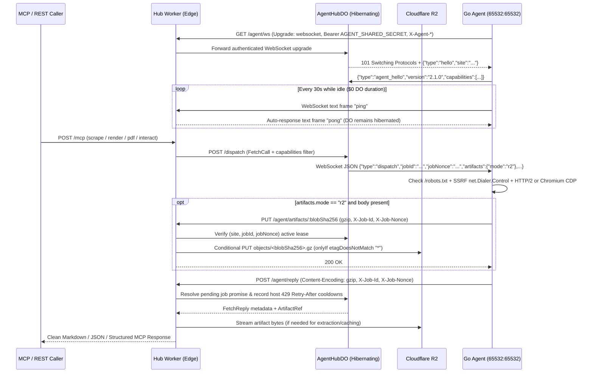

# EdgeFetch Hub ↔ Go Agent Wire Protocol (`v2.1`)

This document specifies the control-plane and out-of-band artifact streaming protocol between the **Cloudflare Hub** (`AgentHubDO` Hibernating WebSocket Durable Object + Worker R2 gateway) and **EdgeFetch Go Standby Nodes** (`internal/agent` + `internal/ws`).

---

## 1. Design Goals

1. **Zero Inbound Ports on Edge Nodes:** Workers behind residential NAT, CGNAT, Tailscale, VPS firewalls, or Home Assistant OS initiate outbound-only `TLS 1.3` connections (`wss://<hub>/agent/ws`).
2. **$0 Idle Hibernation:** Cloudflare's `ctx.acceptWebSocket` + `setWebSocketAutoResponse(new WebSocketRequestResponsePair("ping", "pong"))` answers keepalives at the edge without waking the Durable Object JS isolate.
3. **Zero Large Bodies in Durable Object RAM:** Multi-megabyte HTML/PDF responses bypass `AgentHubDO` via direct content-addressed `PUT /agent/artifacts/:blobSha256` uploads into Cloudflare R2.
4. **Job-Scoped Cryptographic Capability (`jobId` + `jobNonce`):** Every dispatched job carries a fresh CSPRNG `jobNonce` verified in constant time on both artifact `PUT`s and final `POST /agent/reply` completion.

---

## 2. Sequence Diagram



---

## 3. WebSocket Handshake (`GET /agent/ws`)

### Request Headers (Agent → Hub)

| Header | Required | Example | Description |
| :--- | :---: | :--- | :--- |
| `Authorization` | Yes | `Bearer <token>` | Must match `AGENT_SHARED_SECRET` (or site-scoped token) via constant-time SHA-256 comparison (`>= 24` chars). |
| `X-Agent-Site` | Yes | `mac-mini-arm64` | Lowercase node ID matching `^[a-z0-9][a-z0-9_-]{0,31}$`. Only 1 active socket per `site`; reconnects evict stale sockets cleanly. |
| `X-Agent-Arch` | Yes | `arm64` / `amd64` | Go `runtime.GOARCH`. |
| `X-Agent-Version` | Yes | `2.1.0` | Binary version reported in `/admin` fleet telemetry. |
| `X-Agent-Capabilities` | Yes | `http2-v1,scrape-v2,llms-v1,browser-v1,interact-v1,pdf-v1` | Comma-separated capability tokens used by `AgentHubDO` to route `kind: "render"` / `interact` jobs exclusively to Chromium-capable Fat nodes. |

### TLS & Framing Invariants (`internal/ws`)
* **ALPN:** Strictly `http/1.1` (RFC 6455 `Upgrade: websocket`).
* **TLS Curves:** Classic `X25519`, `P-256`, `P-384` (`ws.ClassicTLSConfig()`) to avoid residential middlebox drops on oversized post-quantum `ClientHello` packets.
* **Compression:** `permessage-deflate` disabled (`CompressionDisabled`) to bound memory per idle socket and prevent decompression bombs.
* **Max Frame Size:** `1 MiB` (`maxControlMessageBytes`).

### Post-Connect `agent_hello` Frame (Agent → Hub)
Immediately after receiving `101 Switching Protocols`, the Go agent transmits a JSON text frame persisted via `ws.serializeAttachment(...)` so node metadata survives Durable Object hibernation cycles:

```json
{
  "type": "agent_hello",
  "version": "2.1.0",
  "arch": "arm64",
  "goVersion": "go1.26.2",
  "capabilities": ["http2-v1", "scrape-v2", "llms-v1", "browser-v1", "interact-v1", "pdf-v1"],
  "reconnectAttempt": 0,
  "lastError": ""
}
```

---

## 4. Job Dispatch Envelope (`Hub → Agent`)

When `AgentHubDO` selects an idle, non-cooled-down node matching the job's required capabilities (preferring domain affinity + round-robin fairness), it sends a `"dispatch"` text frame:

```json
{
  "type": "dispatch",
  "jobId": "job_0195f2c8e4a07b12",
  "jobNonce": "9d81c4f0a2b7e13489c01f2d3e4a5b6c7d8e9f0011223344",
  "trace": {
    "X-Request-Id": "req_88a12f"
  },
  "artifacts": {
    "mode": "r2",
    "retention": "stored",
    "maxContentBytes": 16777216
  },
  "call": {
    "maxSeconds": 45,
    "options": {
      "concurrency": 1,
      "pauseMs": 3000,
      "pauseJitterMs": 1500,
      "timeoutMs": 30000,
      "includeBody": true,
      "respectRobots": true
    },
    "requests": [
      {
        "id": "r1",
        "url": "https://example.com/docs",
        "kind": "scrape",
        "formats": ["markdown", "links"]
      }
    ]
  }
}
```

**Agent-Enforced Pacing Floor:** Regardless of `call.options.pauseMs` sent by the Hub, the Go agent clamps `Concurrency = 1` and enforces `PauseMs >= cfg.PauseMs` (minimum `1000ms`), `RespectRobots` (unless explicitly bypassed by host operator config), and `WithBlockedHost(hubHost)` (preventing recursive fetches of the Hub itself).

---

## 5. Out-of-Band R2 Artifact Upload (`PUT /agent/artifacts/:blobSha256`)

When `artifacts.mode == "r2"` and `call.options.includeBody == true`, the Go agent compresses each raw response body with `gzip`, computes both `contentSha256` (uncompressed) and `blobSha256` (compressed), clears `Result.Body` from memory, and uploads the gzipped bytes directly to the Hub Worker:

* **Endpoint:** `PUT /agent/artifacts/<blobSha256>`
* **Headers:**
  * `Authorization: Bearer <agent_token>`
  * `Content-Type: application/gzip`
  * `X-Agent-Site: <site_id>`
  * `X-Job-Id: <jobId>`
  * `X-Job-Nonce: <jobNonce>`
  * `X-Request-Id: <request.id>`
  * `X-Content-Sha256: <64-hex>`
  * `X-Content-Bytes: <uncompressed-byte-length>`
  * `X-Artifact-Retention: stored | transient`
* **Deduplication:** Hub writes to R2 using conditional `onlyIf: { etagDoesNotMatch: "*" }` and verifies the SHA-256 digest on stream completion, returning an `ArtifactRef` attached to `Result.Artifact`.

---

## 6. Job Completion (`POST /agent/reply`)

Once the batch completes (or drains under `SIGTERM`), the Go agent uploads the gzipped JSON `crawl.FetchReply` envelope:

* **Endpoint:** `POST /agent/reply`
* **Headers:**
  * `Authorization: Bearer <agent_token>`
  * `Content-Type: application/json`
  * `Content-Encoding: gzip`
  * `X-Agent-Site: <site_id>`
  * `X-Job-Id: <jobId>`
  * `X-Job-Nonce: <jobNonce>`
* **Cooldown Propagation:** If any `Result` in `FetchReply.Results` reports `outcome: "stop"` or `outcome: "challenge"` (or `retryAfterMs > 0`), `AgentHubDO` marks `(site, hostname)` cooled down so subsequent requests for that origin automatically fail over to a healthy node on a different residential/VPS egress IP.
