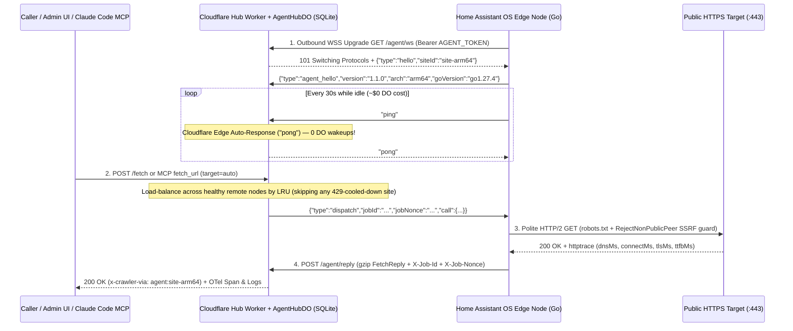
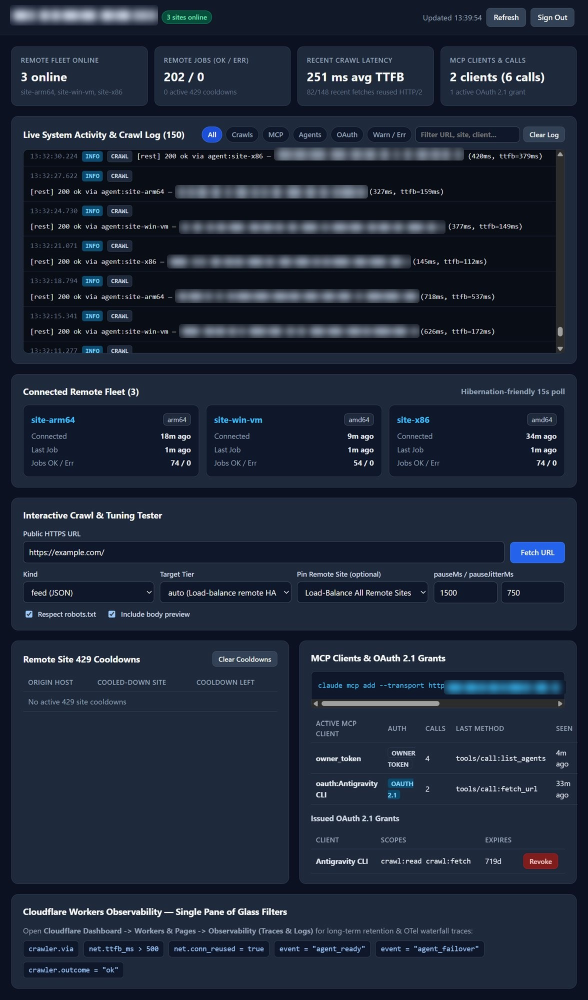

# EdgeFetch Operations, C&C Protocol, Tuning, `/admin` & MCP Guide

<p>
  <a href="https://deploy.workers.cloudflare.com/?url=https://github.com/bartrumb/edgefetch/tree/main/hub">
    
  </a>
  &nbsp;
  <a href="https://my.home-assistant.io/redirect/supervisor_add_addon_repository/?repository_url=https%3A%2F%2Fgithub.com%2Fbartrumb%2Fedgefetch">
    
  </a>
</p>

## 1. Security Boundary: Hub vs. Edge Nodes

EdgeFetch strictly separates **coordination/control** from **edge execution**:

- **Cloudflare Hub (`hub/`):** The **only** public HTTPS surface. Hosts the Web Control Center (`/admin`), the Stateless Streamable HTTP MCP server (`/mcp`), Self-Hosted OAuth 2.1 (`/.well-known/*`, `/oauth/*`), the REST API (`POST /fetch`, `GET /agents`), and the Hibernating WebSocket coordinator (`GET /agent/ws`, `POST /agent/reply`).
- **Edge Nodes (Home Assistant OS / Docker Go binary):** Host **zero** inbound ports, **zero** `/admin` UI, and **zero** `/mcp` server. Edge nodes drop root privileges (`65532:65532`), dial outbound `wss://` to `GET /agent/ws`, and only execute polite `https://:443` public fetches dispatched by their configured Hub.

---

## 2. How the Outbound C&C Lifecycle Works



### Public-IP Load Splitting, Host-Sticky Affinity & Polite `429` Failover
- **Public-IP Egress Grouping + 30m Host-Sticky Affinity (Tier 1 Primary):** `AgentHubDO` captures each node's verified public IP (`cf-connecting-ip`) and EdgeFetch/Go version on connect. Unpinned origin hosts are assigned to the Least-Recently-Used `publicIp` group (so two VMs sharing one WAN router receive 1 combined share, not 2) and stay **sticky to that node for 30 minutes** (`HOST_STICKY_TTL_MS`) so single origins never rotate IPs across sequential calls. Concurrent calls to the same host queue through a race-free FIFO lock (`withHostLocks`).
- **Polite 3-Strikes `429` Adaptive Backoff + Full `Retry-After` Wait:** On HTTP `429` (`outcome !== "challenge"`), each node executes up to **3 adaptive attempts ("3 strikes and you're out")**, honoring `Retry-After` (or `4 s` → `10 s` exponential backoff + jitter when `Retry-After` is absent) whenever within the call's remaining deadline. If all 3 strikes return `429` (or `Retry-After` exceeds the call budget), `AgentHubDO` cools down both `siteId` and `ip:<publicIp>` in SQLite (`site_cooldowns`) and waits out `Retry-After` (`15 s` default) before dispatching failover to a distinct-IP node or Cloudflare overflow.
- **Cloudflare Overflow ONLY on `429` (Tier 2 Fallback):** Cloudflare egress (`cloudflareOverflowFetch`, enforcing `pauseMs` and `/robots.txt` by default) stays asleep during normal operation and runs **only** after waiting out `Retry-After` / `15 s` when remote nodes hit `429` (or when zero remote nodes are connected). Responses like `200`, `304`, `403`, `404`, `503`, and `cf-mitigated` challenges never wake Cloudflare.

---

## 3. Two-Tier Politeness & Tuning Reference

EdgeFetch uses a **two-tier tuning model** so upstream callers can tune crawls per job without ever overriding an edge node's local safety floor:

### Tier A — Edge Node Local Safety Floor (Home Assistant Add-on UI / Env)

| Option / Env | Default | Behavior |
|---|---|---|
| `pause_ms` (`EDGEFETCH_PAUSE_MS`) | `3000` (add-on) / `1500` (env default) | **Hard minimum** per-host delay in ms. Upstream calls requesting a smaller `pauseMs` are clamped up to this floor. |
| `pause_jitter_ms` (`EDGEFETCH_PAUSE_JITTER_MS`) | `1500` (add-on) / `750` (env default) | **Hard minimum** random positive jitter (`[0, jitter)`) added to `pause_ms` on every fetch. |
| `allowed_hosts` (`EDGEFETCH_ALLOWED_HOSTS`) | `[]` (all public HTTPS) | Optional domain suffix allowlist (e.g. `example.com` permits `example.com` and `*.example.com`). Regardless of this list, `RejectNonPublicPeer` **always** blocks RFC 1918 LANs, loopback, Tailscale `100.64/10`, cloud metadata, and NAT64/6to4/Teredo IPv6 ranges at dial time. |
| `robots_bypass_hosts` (`EDGEFETCH_ROBOTS_BYPASS_HOSTS`) | `[]` (strict RFC 9309 on all hosts) | Owner-explicit domain suffix allowlist (paired with `ROBOTS_BYPASS_HOSTS` on the Hub) permitting `respectRobots: false` **only** on domains you own or hold explicit partner authorization to crawl. Audited in `hub_events`. |
| `Concurrency` | Fixed `1` on agents | Edge nodes always serialize outbound jobs (`Concurrency = 1`) to protect residential upload bandwidth. |

### Tier B — Per-Call Request & Tuning Schema (`POST /fetch`)

- `POST https://<your-hub>.workers.dev/fetch` — auto-selects sticky/LRU site
- `POST https://<your-hub>.workers.dev/fetch?site=site-arm64` — pins a specific standby site

```bash
curl -X POST "https://<your-hub>.workers.dev/fetch?site=site-arm64" \
  -H "Authorization: Bearer $CALLER_TOKEN" \
  -H "Content-Type: application/json" \
  -d '{
    "maxSeconds": 60,
    "options": {
      "includeBody": true,
      "respectRobots": true,
      "pauseMs": 2000,
      "pauseJitterMs": 1000,
      "gapMs": 2000,
      "timeoutMs": 30000,
      "maxBytes": 8388608,
      "retries": 1
    },
    "requests": [
      {
        "id": "feed-1",
        "url": "https://example.com/feed.json",
        "kind": "feed",
        "ifNoneMatch": "\"etag-from-previous-run\""
      }
    ]
  }'
```

| Field | Default / Max | Description |
|---|---|---|
| `requests[].kind` | `"page"` \| `"json"` \| `"text"` \| `"feed"` | `"page"` for HTML documents (`text/html`), `"json"` for any valid 2xx JSON API, `"text"` for plain text/XML/sitemaps, or `"feed"` for product feeds requiring a top-level `"products"` array. |
| `requests[].ifNoneMatch` / `ifModifiedSince` | optional | Conditional `304 Not Modified` headers — saves bandwidth when upstream content hasn't changed. |
| `options.includeBody` | `false` | Set `true` to return response bodies alongside `bodyEncoding` (`"utf-8"` or lossless `"base64"` for non-UTF-8 responses). |
| `options.respectRobots` | **`true` (locked on by default)** | Enforces 100% RFC 9309 `/robots.txt` (`1 MiB` parse cap, §2.2.1 group combining, §2.3.1.2 `5`-redirect follow, §2.4 `Cache-Control: max-age` up to 24h, `60s` `robots_unreachable` retry cache, and `Content-Signal: ai-input=no`) on the initial URL **and every redirect hop**. Passing `false` is rejected (`400 robots_required`) unless the target host is in the owner's `ROBOTS_BYPASS_HOSTS` + `EDGEFETCH_ROBOTS_BYPASS_HOSTS` allowlist. |
| `options.maxBytes` / `maxTotalBytes` | `8 MiB` (`16 MiB` max) / `16 MiB` (`18 MiB` max) | Per-URL streaming cap (`io.LimitReader(maxBytes + 1)`) plus per-batch retained body budget (`bodyOmitted: true` + `truncated: true` beyond budget). |
| `options.retries` | `0` (max `3`) | Retries transient transport/`500`/`502`/`504` errors (`>= 25%` jitter floor). HTTP `429` uses dedicated 3-strikes adaptive `Retry-After` backoff; permanent SSRF/TLS refusals, `403`, `503`, and challenges are **never** retried on the node. |

---

## 4. Built-in Web Control Center (`/admin`)

<p align="center">
  
</p>

Open `https://<your-hub>.workers.dev/admin` in any browser and sign in with your `CALLER_TOKEN`:

- **Session Security:** Uses an 8-hour HMAC-SHA256 `HttpOnly; Secure; SameSite=Lax` cookie, per-session CSRF token (`x-csrf-token`), strict CSP (`frame-ancestors 'none'`), and SQLite brute-force rate limiting (`5` failures / `5m` -> `429`).
- **Capabilities:**
  1. **KPI Strip & Live System Activity / Crawl Log:** 300-event SQLite ring buffer filterable by `Crawls`, `MCP`, `Agents`, `OAuth`, and `Warn / Err`, plus avg TTFB and HTTP/2 connection-reuse telemetry (hibernation-friendly 15s polling).
  2. **Connected Remote Fleet Cards:** Real-time connected sites, CPU architecture (`amd64` / `arm64`), uptime, last job time, `jobsOk` / `jobsErr` counters, and 1-click `+ Add HAOS Node` / `Deploy Hub on Cloudflare` buttons.
  3. **Interactive Crawl & Tuning Runner:** Test any `https://` URL across `feed`/`page`, pin a specific site, tune `pauseMs` / `pauseJitterMs` / `robots`, and inspect a visual **DNS / TCP / TLS / TTFB** waterfall bar + JSON reply.
  4. **Remote Site 429 Cooldowns & Active OAuth 2.1 MCP Grants:** Inspect any per-site `429` cooldowns (`host -> siteId`, remaining TTL) alongside active MCP clients (`owner_token` and OAuth 2.1 grants) with 1-click session revocation.

---

## 5. Connecting Claude Code via Self-Hosted OAuth 2.1 MCP (`/mcp`)

`hub/` hosts a complete, zero-external-IdP **OAuth 2.1 + PKCE (`S256`) + Dynamic Client Registration (RFC 7591)** server backed directly by `AgentHubDO` SQLite (requiring **zero** separate KV namespaces or third-party auth providers):

- `GET /.well-known/oauth-protected-resource` (RFC 9728 Protected Resource Metadata)
- `GET /.well-known/oauth-authorization-server` (RFC 8414 Authorization Server Metadata)
- `POST /oauth/register` (RFC 7591 Dynamic Client Registration — IP rate-limited; restricted to loopback `http://localhost` / `127.0.0.1` / `[::1]` callbacks by default, or external `https://` hosts listed in `OAUTH_REDIRECT_ALLOWLIST`)
- `GET` / `POST /oauth/authorize` (Confused-deputy-safe consent screen labeling self-reported client names, rejecting unknown scopes with `invalid_scope`, and requiring explicit `CALLER_TOKEN` entry for any non-loopback redirect)
- `POST /oauth/token` & `POST /oauth/revoke` (Single-use 90s auth codes requiring `client_id` + `redirect_uri`, constant-time PKCE `S256`, 1h access tokens, atomic 30d refresh-token rotation with immediate full-grant revocation on replay)

### Add Directly to Claude Code

```bash
claude mcp add --transport http edgefetch https://<your-hub>.workers.dev/mcp
```

When Claude Code connects for the first time, it discovers `/.well-known/oauth-protected-resource`, registers dynamically, and opens your browser to `/oauth/authorize`. Paste your `CALLER_TOKEN` once (or click **Approve** immediately if already signed into `/admin`) — **no raw bearer tokens are ever saved in `.claude.json` or shell history**.

### Exposed MCP Tools (12-Tool v2.4 Surface)

| Tool | Required Scope | Description |
|---|---|---|
| `list_agents` | `crawl:read` | Lists connected standby agents (`siteId`, `LITE`/`FAT` tier, `capabilities`, `version`, `arch`) and active `429` cooldowns. |
| `scrape` | `crawl:fetch` | Scrapes a public `https://` URL to clean GFM Markdown, Jupyter `.ipynb`, OpenAPI 3.x, CSV, `.ics`, metadata, `contentState`, `waf` diagnostics, SSR hydration recovery, `304` `ETag` revalidation, and optional `waybackFallback`. |
| `extract` | `crawl:fetch` | Fetches 1..20 URLs politely and returns BM25 query-ranked ~1,500-char chunks (`chunksPerSource`) or full documents (`mode: "full"`), with `jsonFilter` and optional `waybackFallback`. |
| `map` | `crawl:fetch` | Discovers site URLs across `robots.txt` `Sitemap:`, `sitemap.xml` / `.xml.gz`, `/llms.txt`, and homepage links with anchor titles. |
| `crawl` | `crawl:fetch` | Starts an async breadth-first site crawl (`includePaths`/`excludePaths`, D1 FTS5 indexing, HMAC webhooks), or polls/cancels `crawlId`. |
| `search` | `crawl:read` | Searches Serper, Brave, Tavily, SearXNG JSON, `edge-map`, and/or private `SEARCH` D1 FTS5 `collections` via cost-efficient waterfall or Reciprocal Rank Fusion (`RRF`). |
| `jobs` | `crawl:fetch` | One-call structured ATS job search & saved-link `verify` check across Greenhouse, Ashby, Lever, Workday CXS, SmartRecruiters, iCIMS, and public feeds with standardized pay (`basis: "base"\|"ote"\|"total"`), truncation metadata, and closed-role filtering. |
| `catalog` | `crawl:fetch` | Polite full-store product & variant inventory extraction (`Shopify` custom domains & `/products.json`, `WooCommerce` Store API) with `2s` per-host pacing, `429 Retry-After` cooldowns, `<50%` shrink guard, R2 NDJSON snapshots, and variant-level diffs. |
| `search_collection` | `crawl:read` | Queries a specific crawled `SEARCH` D1 FTS5 collection directly via BM25 ranking. |
| `interact` | `crawl:fetch` | Drives a sandboxed headless Chromium session on a `browser-v1` node (`click`, `fill`, `press`, `scroll`, `wait`, PNG screenshots, YouTube transcripts). |
| `read_artifact` | `crawl:read` | Pages stored artifacts by `artifactId` (`blobSha256` or `md:<sha256>`) + `offset` + `limit` (`format: "raw"\|"markdown"`). |
| `fetch_url` | `crawl:fetch` | Low-level single-URL fetch returning status, `httptrace` phase timing, `stageTimingsMs`, headers, `waf`, and outcome. |
| `fetch_batch` | `crawl:fetch` | Low-level multi-URL batch fetch (`concurrency: 4`) across `page` / `json` / `text` / `feed` / `pdf` kinds. |

---

## 6. v2.4 REST Endpoints, Verified Bot Auth, Storage Layers & Compatibility Routes

| Endpoint | Description |
|---|---|
| `GET /.well-known/http-message-signatures-directory` | Public unauthenticated IETF RFC 9421 Web Bot Auth `Ed25519` JWKS directory (`application/http-message-signatures-directory+json`, `edgefetch keygen-bot-auth`). |
| `GET /.well-known/edgefetch-bot.json` | Public bot transparency & policy manifest (`strict-rfc9309` `robots.txt`, `halt-immediately-never-bypass` on challenges, active signing `kid`s). |
| `GET /v1/capabilities` | Reports active bindings (`artifacts`, `tracking`, `ingestWorkflow`, `search`, `webSearch`, `crawl`, `interact`, `webBotAuth`, `spaFallback`, `spaFallbacks`). |
| `GET /v1/hosts` | Returns adaptive per-host politeness & health ledger (`okCount`, `rateLimit429Count`, `challengeCount`, `error5xxCount`, `ewmaTtfbMs`, `recommendedPauseMs`, `lastWafVendor`). |
| `POST /v1/scrape` | Clean Markdown, `/llms.txt` + `.md` upgrade, `{type:"json",schema}`, `jsonFilter`, `304` `ETag` revalidation, Next.js RSC / `__NEXT_DATA__` / Nuxt SSR hydration, `spaFallback` (`Crawl4AI` / `Firecrawl`), `contentState`, `waybackFallback`. |
| `POST /v1/extract` | Multi-URL polite batch extraction + BM25 query-ranked chunks (`urls`, `query`, `jsonFilter`, `chunksPerSource`, `waybackFallback`). |
| `POST /v1/jobs` | Structured multi-ATS job discovery & extraction (`query`, `company`, `remote`, `locations`, `minBase`, `postedWithinDays`, `exclude`). |
| `POST /v1/map` | Rapid polite URL discovery (`robots.txt`, sitemaps, `/llms.txt`, homepage links, `search` filter). |
| `POST /v1/crawl`, `GET\|DELETE /v1/crawl/:id` | Async site crawl tracked in `META` D1 `crawls` + indexed in `SEARCH` D1 FTS5 + HMAC-SHA256 webhooks (`X-EdgeFetch-Signature`). |
| `POST /v1/search` & `POST /v1/collections/:id/search` | Waterfall / RRF web + private D1 FTS5 search (`SERPER_API_KEY`, `BRAVE_API_KEY`, `SEARXNG_URL`, `collections`, `include_raw_content`). |
| `POST /v1/interact` | Stateful headless browser interaction routed to `edgefetch_fat` (`browser-v1`) nodes. |
| `GET /v1/artifacts/:blobSha256` | Authenticated offset-paged artifact reader (`text/plain; charset=utf-8`, `nosniff`, `CSP: sandbox`, `410 Gone` when expired). |
| `/compat/firecrawl/v2/*` & `/compat/tavily/*` | Drop-in compatibility routes for existing Firecrawl v2 and Tavily SDK clients. |

### Optional Three-Layer Cloudflare Storage (`ARTIFACTS` R2 + `META` D1 + `SEARCH` D1 FTS5)
All storage bindings in [`hub/wrangler.toml`](../hub/wrangler.toml) are optional. When enabled:
- **`ARTIFACTS` R2 Bucket:** Configure two prefix lifecycle expiration rules: `tmp/` -> **1 day**, `raw/` -> **30 days**. Derived Markdown lives under `derived/<pipelineVersion>/markdown/<contentSha256>`.
- **`META` D1 (`hub/migrations/meta/0001_tracking.sql`):** Tracks `artifacts` (`verified_at`), `pages`, `fetches` (90-day scheduled prune), `documents`, and `crawls`.
- **`SEARCH` D1 (`hub/migrations/search/0001_fts.sql`):** External-content `FTS5` (`porter unicode61 remove_diacritics 2`) with atomic `DELETE` + `INSERT` page replacement and a 7 GB warn / 9 GB stop capacity guard.

---

## 7. Single-Pane-of-Glass Observability (Cloudflare & Vendor-Agnostic OpenTelemetry OTLP)

### A. Vendor-Agnostic OpenTelemetry Collector (`OTLP/HTTP` + W3C `traceparent`)

Both the Hub (`hub/src/otel.ts`) and the Go binary (`internal/otel/otlp.go`) natively export OpenTelemetry `ExportTraceServiceRequest` JSON batches (`POST <endpoint>/v1/traces`) and propagate standard W3C `traceparent` (`00-<traceId>-<spanId>-01`) headers across `/agent/ws` and `POST /fetch` so Hub dispatch and remote Go `httptrace` (`net.dns_ms`, `net.connect_ms`, `net.tls_ms`, `net.ttfb_ms`, `net.conn_reused`) appear as parent/child spans in **one unified trace waterfall**!

Configure on Cloudflare (`wrangler secret put`), Docker, Fly.io, Railway, Render, or Go CLI using standard OTel variables:

```bash
# Examples: Honeycomb, Grafana Cloud Tempo, Axiom, SigNoz, or self-hosted Jaeger (:4318)
OTEL_EXPORTER_OTLP_ENDPOINT="https://api.honeycomb.io"
OTEL_EXPORTER_OTLP_HEADERS="x-honeycomb-team=<YOUR_API_KEY>"
OTEL_SERVICE_NAME="edgefetch-hub"
```

Spans flush via `ctx.waitUntil(...)` on Edge runtimes and a bounded non-blocking background channel in Go, adding **0 ms** to caller response latency.

### B. Cloudflare Native Logs & Traces

`hub/wrangler.toml` also enables native `[observability.logs]` and `[observability.traces]` at `100%` sampling:

1. Open **Cloudflare Dashboard -> Workers & Pages -> `edgefetch-hub` -> Observability**.
2. **Traces tab:** Inspect end-to-end `edgefetch.dispatch` spans tagged with `edgefetch.via` and HTTP status codes.
3. **Logs tab:** Query structured JSON events (`agent_ready`, `agent_reconnected`, `fetch_forwarded`, `agent_failover`) across every connected edge site in one place.

---

## 8. High Availability (HA), Multi-Controller Fan-Out & Self-Hosted Go Mesh

EdgeFetch supports four composable HA layers with zero external consensus brokers:

1. **Multi-Controller Active-Active Fan-Out (`EDGEFETCH_HUB_URLS`):**
   - Pass a comma-separated list of controllers to any Go agent:
     ```bash
     EDGEFETCH_HUB_URLS="wss://cf-hub.example.com,wss://standby-hub.fly.dev"
     ```
   - `agent.RunAll` maintains simultaneous outbound WebSocket sessions to every controller sharing one in-process `*crawl.Crawler` and `*politeness.Registry`. Even if two controllers dispatch jobs for the same domain simultaneously, `politeness.HostState` serializes per-host traffic locally.
2. **Cloudflare Durable Object Shard Ring (`HUB_SHARDS`):**
   - Set `HUB_SHARDS="global,standby"` on the Cloudflare Hub Worker and connect agents to `?shard=global` / `?shard=standby` so single-isolate DO maintenance or evictions fail over in `<10ms`.
3. **Self-Hosted Go Controller & Hybrid Mesh (`--mode=hub` & `--mode=hub,agent`):**
   - Run `edgefetch --mode=hub` on a VPS or `edgefetch --mode=hub,agent` on a Tailscale/LAN box so local nodes connect to a local standby Go controller (`/agent/ws`, `/v1/scrape`, `/fetch`, `/mcp`) while simultaneously serving the upstream cloud Hub.
4. **SDK Multi-Controller Automatic Failover (`baseUrls`):**
   ```ts
   import { EdgeFetchClient } from './sdk/ts/edgefetch-client';

   const client = new EdgeFetchClient({
     baseUrls: ['https://edgefetch.example.com', 'https://standby-go-hub.tailnet.ts.net'],
     token: process.env.CALLER_TOKEN!,
   });
   ```
   `EdgeFetchClient` automatically retries the next controller in `baseUrls` on network errors or `502`/`503`/`504` gateway responses.

---

## 9. Desktop (`stdio` MCP), Kubernetes, Homelab NAS, Routers & Mobile Egress

- **Zero-Daemon Local `stdio` MCP (`Claude Desktop` / `Cursor` / `VS Code` / `Windsurf`):**
  - Run `edgefetch install-mcp` (or add `{"command": "edgefetch", "args": ["mcp"]}`). Auto-discovers pre-installed Windows Edge/Chrome/Brave and macOS Chrome/Edge/Brave via `browser.FindChromeBinary()` — zero background port, zero bearer token.
- **Kubernetes (`deploy/k8s/agent-deployment.yaml`):**
  - Turnkey `Deployment` (`runAsNonRoot: true`, `65532:65532`, `capabilities.drop: ["ALL"]`) paired with a CNI `NetworkPolicy` blocking all ingress and blocking RFC 1918 / CGNAT / link-local egress at the cluster network layer.
- **Homelab & NAS App Templates:**
  - **Unraid:** [`deploy/unraid/edgefetch-agent.xml`](../deploy/unraid/edgefetch-agent.xml)
  - **CasaOS / Portainer / Coolify:** [`deploy/casaos/docker-compose.yml`](../deploy/casaos/docker-compose.yml)
- **Routers, Firewalls & Mobile Standby Nodes (`CGO_ENABLED=0`):**
  - **MikroTik RouterOS v7:** Pull `ghcr.io/bartrumb/edgefetch-agent:lite` (~9 MB distroless `arm64`/`amd64`).
  - **OpenWrt / GL.iNet Travel Routers:** Cross-compiled via `.goreleaser.yaml` (`linux/mipsle` `softfloat`, `linux/arm` `v7`, `linux/arm64`).
  - **OPNsense / pfSense:** Cross-compiled `freebsd/amd64` & `freebsd/arm64` static binaries.
  - **Android (Termux):** Build `GOOS=linux GOARCH=arm64` + `termux-wake-lock` on spare Wi-Fi / 5G phones (~15 MB RAM).

---

## 10. Structured Job Search & ATS Intelligence (`POST /v1/jobs` & MCP `jobs`)

EdgeFetch includes built-in adapters for major Applicant Tracking Systems (**Ashby**, **Workday CXS `GET` & `POST`**, **Greenhouse**, **Lever**, and **SmartRecruiters / Schema.org `JobPosting` JSON-LD**) alongside per-record JSON array chunking (`jsonFilter`), automatic thin-page browser upgrades (`renderMode: "auto"`), and standardized compensation parsing:

```bash
curl -sS https://<your-hub>/v1/jobs \
  -H "Authorization: Bearer $CALLER_TOKEN" \
  -H "Content-Type: application/json" \
  -d '{
    "query": "Forward Deployed Engineer",
    "remote": true,
    "minBase": 200000,
    "postedWithinDays": 14,
    "limit": 20,
    "exclude": [{ "company": "ExampleCorp", "title": "Forward Deployed Engineer" }]
  }'
```

- **Standardized Compensation (`pay`):** Every parsed posting normalizes `{ min, max, currency, period, basis: "base" | "ote" | "total" }`, scaling shorthand annual thousands (e.g., Ashby `230`–`350` → `230000`–`350000`) and keeping `total` target cash / `ote` distinct from `base` salary.
- **Per-Record JSON Array Chunking (`jsonFilter`):** Passing `jsonFilter` (e.g., `title~"Forward Deployed"`) to `scrape` or `extract` on JSON array endpoints emits **1 chunk = 1 record** and converts embedded HTML fields into clean Markdown so attributes never bleed across records.
- **Ethical Block Handling (`blocked`):** EdgeFetch strictly honors `robots.txt` and anti-bot challenges, returning `blocked: { reason: "robots" | "challenge", host, suggestion }` to guide agents toward clean official ATS boards.
