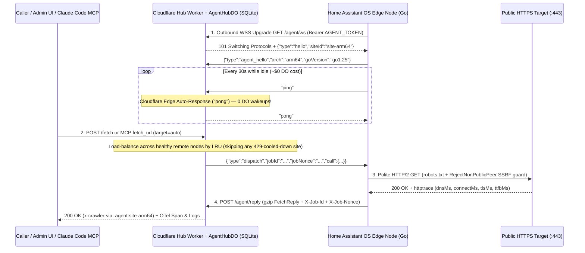

# EdgeFetch Operations, C&C Protocol, Tuning, `/admin` & MCP Guide

<p>
  <a href="https://deploy.workers.cloudflare.com/?url=https://github.com/bartrumb/edgefetch/tree/main/hub">
    
  </a>
  &nbsp;
  <a href="https://my.home-assistant.io/redirect/supervisor_add_addon_repository/?repository_url=https%3A%2F%2Fgithub.com%2Fbartrumb%2Fedgefetch">
    
  </a>
</p>

## 1. Security Boundary: Hub vs. Edge Nodes

EdgeFetch strictly separates **coordination/control** from **edge execution**:

- **Cloudflare Hub (`hub/`):** The **only** public HTTPS surface. Hosts the Web Control Center (`/admin`), the Stateless Streamable HTTP MCP server (`/mcp`), Self-Hosted OAuth 2.1 (`/.well-known/*`, `/oauth/*`), the REST API (`POST /fetch`, `GET /agents`), and the Hibernating WebSocket coordinator (`GET /agent/ws`, `POST /agent/reply`).
- **Edge Nodes (Home Assistant OS / Docker Go binary):** Host **zero** inbound ports, **zero** `/admin` UI, and **zero** `/mcp` server. Edge nodes drop root privileges (`65532:65532`), dial outbound `wss://` to `GET /agent/ws`, and only execute polite `https://:443` public fetches dispatched by their configured Hub.

---

## 2. How the Outbound C&C Lifecycle Works



### Public-IP Load Splitting, Host-Sticky Affinity & Polite `429` Failover
- **Public-IP Egress Grouping + 30m Host-Sticky Affinity (Tier 1 Primary):** `AgentHubDO` captures each node's verified public IP (`cf-connecting-ip`) and EdgeFetch/Go version on connect. Unpinned origin hosts are assigned to the Least-Recently-Used `publicIp` group (so two VMs sharing one WAN router receive 1 combined share, not 2) and stay **sticky to that node for 30 minutes** (`HOST_STICKY_TTL_MS`) so single origins never rotate IPs across sequential calls. Concurrent calls to the same host queue through a race-free FIFO lock (`withHostLocks`).
- **Polite `429` Cooldown + Full `Retry-After` Wait:** On HTTP `429` (`outcome !== "challenge"`), `AgentHubDO` cools down both `siteId` and `ip:<publicIp>` in SQLite (`site_cooldowns`) and **waits out the full `Retry-After` duration** (`15 s` default when `Retry-After` is absent) inside the FIFO host lock **before** dispatching failover to a healthy distinct-IP node or Cloudflare overflow. If `Retry-After` exceeds the remaining `maxSeconds` budget, the `429` is returned directly without failing over.
- **Cloudflare Overflow ONLY on `429` (Tier 2 Fallback):** Cloudflare egress (`CrawlerContainer` or Worker `cloudflareOverflowFetch`, enforcing `pauseMs` and `/robots.txt` by default) stays asleep during normal operation and runs **only** after waiting out `Retry-After` / `15 s` when remote nodes hit `429` (or when zero remote nodes are connected). Responses like `200`, `304`, `403`, `404`, `503`, and `cf-mitigated` challenges never wake Cloudflare.

---

## 3. Two-Tier Politeness & Tuning Reference

EdgeFetch uses a **two-tier tuning model** so upstream callers can tune crawls per job without ever overriding an edge node's local safety floor:

### Tier A — Edge Node Local Safety Floor (Home Assistant Add-on UI / Env)

| Option / Env | Default | Behavior |
|---|---|---|
| `pause_ms` (`EDGEFETCH_PAUSE_MS`) | `1500` | **Hard minimum** per-host delay in ms. Upstream calls requesting a smaller `pauseMs` are clamped up to this floor. |
| `pause_jitter_ms` (`EDGEFETCH_PAUSE_JITTER_MS`) | `750` | **Hard minimum** random positive jitter (`[0, jitter)`) added to `pause_ms` on every fetch. |
| `allowed_hosts` (`EDGEFETCH_ALLOWED_HOSTS`) | `[]` (all public HTTPS) | Optional domain suffix allowlist (e.g. `example.com` permits `example.com` and `*.example.com`). Regardless of this list, `RejectNonPublicPeer` **always** blocks RFC 1918 LANs, loopback, Tailscale `100.64/10`, cloud metadata, and NAT64/6to4/Teredo IPv6 ranges at dial time. |
| `Concurrency` | Fixed `1` on agents | Edge nodes always serialize outbound jobs (`Concurrency = 1`) to protect residential upload bandwidth. |

### Tier B — Per-Call Request & Tuning Schema (`POST /fetch`)

- `POST https://<your-hub>.workers.dev/fetch` — auto-selects sticky/LRU site
- `POST https://<your-hub>.workers.dev/fetch?site=site-arm64` — pins a specific standby site

```bash
curl -X POST "https://<your-hub>.workers.dev/fetch?site=site-arm64" \
  -H "Authorization: Bearer $CALLER_TOKEN" \
  -H "Content-Type: application/json" \
  -d '{
    "maxSeconds": 60,
    "options": {
      "includeBody": true,
      "respectRobots": true,
      "pauseMs": 2000,
      "pauseJitterMs": 1000,
      "gapMs": 2000,
      "timeoutMs": 30000,
      "maxBytes": 8388608,
      "retries": 1
    },
    "requests": [
      {
        "id": "feed-1",
        "url": "https://example.com/feed.json",
        "kind": "feed",
        "ifNoneMatch": "\"etag-from-previous-run\""
      }
    ]
  }'
```

| Field | Default / Max | Description |
|---|---|---|
| `requests[].kind` | `"feed"` \| `"page"` | `"feed"` sends `Accept: application/json` and validates JSON structure; `"page"` sends `Accept: text/html,application/xhtml+xml`. |
| `requests[].ifNoneMatch` / `ifModifiedSince` | optional | Conditional `304 Not Modified` headers — saves bandwidth when upstream content hasn't changed. |
| `options.includeBody` | `false` | Set `true` to return the response UTF-8 body string alongside status/headers/timing. |
| `options.respectRobots` | **`true` by default** (alias `robots` also accepted; pass `false` to opt out) | Fetches & caches `/robots.txt` per host for 24h (`Allow`/`Disallow` longest-match + `Crawl-delay`, assuming complete disallow per RFC 9309 §2.3.1.4 if `/robots.txt` is unreachable or returns `429`/`5xx`). |
| `options.maxBytes` | `8 MiB` (max `16 MiB`) | Streaming body cap via `io.LimitReader(maxBytes + 1)`. Oversized responses stop immediately with `truncated: true`. |
| `options.retries` | `0` (max `3`) | Retries **only** transport/500/502/504 errors on the active node with exponential jitter. `403`, `429`, `503`, and challenges are **never** retried on the node (in `target=auto`, HTTP `429` triggers Hub-level site cooldown + peer/Cloudflare failover). |

---

## 4. Built-in Web Control Center (`/admin`)

<p align="center">
  
</p>

Open `https://<your-hub>.workers.dev/admin` in any browser and sign in with your `CALLER_TOKEN`:

- **Session Security:** Uses an 8-hour HMAC-SHA256 `HttpOnly; Secure; SameSite=Lax` cookie, per-session CSRF token (`x-csrf-token`), strict CSP (`frame-ancestors 'none'`), and SQLite brute-force rate limiting (`5` failures / `5m` -> `429`).
- **Capabilities:**
  1. **KPI Strip & Live System Activity / Crawl Log:** 300-event SQLite ring buffer filterable by `Crawls`, `MCP`, `Agents`, `OAuth`, and `Warn / Err`, plus avg TTFB and HTTP/2 connection-reuse telemetry (hibernation-friendly 15s polling).
  2. **Connected Remote Fleet Cards:** Real-time connected sites, CPU architecture (`amd64` / `arm64`), uptime, last job time, `jobsOk` / `jobsErr` counters, and 1-click `+ Add HAOS Node` / `Deploy Hub on Cloudflare` buttons.
  3. **Interactive Crawl & Tuning Runner:** Test any `https://` URL across `feed`/`page`, pin a specific site, tune `pauseMs` / `pauseJitterMs` / `robots`, and inspect a visual **DNS / TCP / TLS / TTFB** waterfall bar + JSON reply.
  4. **Remote Site 429 Cooldowns & Active OAuth 2.1 MCP Grants:** Inspect any per-site `429` cooldowns (`host -> siteId`, remaining TTL) alongside active MCP clients (`owner_token` and OAuth 2.1 grants) with 1-click session revocation.

---

## 5. Connecting Claude Code via Self-Hosted OAuth 2.1 MCP (`/mcp`)

`hub/` hosts a complete, zero-external-IdP **OAuth 2.1 + PKCE (`S256`) + Dynamic Client Registration (RFC 7591)** server backed directly by `AgentHubDO` SQLite (requiring **zero** separate KV namespaces or third-party auth providers):

- `GET /.well-known/oauth-protected-resource` (RFC 9728 Protected Resource Metadata)
- `GET /.well-known/oauth-authorization-server` (RFC 8414 Authorization Server Metadata)
- `POST /oauth/register` (RFC 7591 Dynamic Client Registration — strictly restricted to loopback `http://localhost` / `127.0.0.1` or external `https://` callbacks)
- `GET` / `POST /oauth/authorize` (Confused-deputy-safe consent screen displaying exact callback host + requested scopes)
- `POST /oauth/token` & `POST /oauth/revoke` (Single-use 90s auth codes, constant-time PKCE `S256`, 1h access tokens, rotating 30d refresh tokens)

### Add Directly to Claude Code

```bash
claude mcp add --transport http edgefetch https://<your-hub>.workers.dev/mcp
```

When Claude Code connects for the first time, it discovers `/.well-known/oauth-protected-resource`, registers dynamically, and opens your browser to `/oauth/authorize`. Paste your `CALLER_TOKEN` once (or click **Approve** immediately if already signed into `/admin`) — **no raw bearer tokens are ever saved in `.claude.json` or shell history**.

### Exposed MCP Tools

| Tool | Required Scope | Description |
|---|---|---|
| `list_agents` | `crawl:read` | Lists connected standby agents (`siteId`, `arch`, `jobsOk`, `jobsErr`) and active 15m domain-affinity pins. |
| `fetch_url` | `crawl:fetch` | Politely fetches a single public `https://` URL (`feed` or `page`, optional `site` pin, `robots`, `ifNoneMatch`) with full phase timing + body preview. |
| `fetch_batch` | `crawl:fetch` | Politely fetches up to 25 public `https://` URLs with configurable `pauseMs` and `pauseJitterMs`. |

*(Direct machine-to-machine MCP clients may also pass `Authorization: Bearer $CALLER_TOKEN` on `POST /mcp`.)*

---

## 6. Single-Pane-of-Glass Observability (Cloudflare Logs & Traces)

`hub/wrangler.toml` enables both `[observability.logs]` and `[observability.traces]` at `100%` sampling:

1. Open **Cloudflare Dashboard -> Workers & Pages -> `edgefetch-hub` -> Observability**.
2. **Traces tab:** Inspect end-to-end `edgefetch.dispatch` / `crawler.fetch` spans tagged with `edgefetch.site` / `crawler.via` and HTTP status codes.
3. **Logs tab:** Query structured JSON events (`agent_ready`, `agent_reconnected`, `fetch_forwarded`, `agent_failover`) across every connected edge site in one place.
